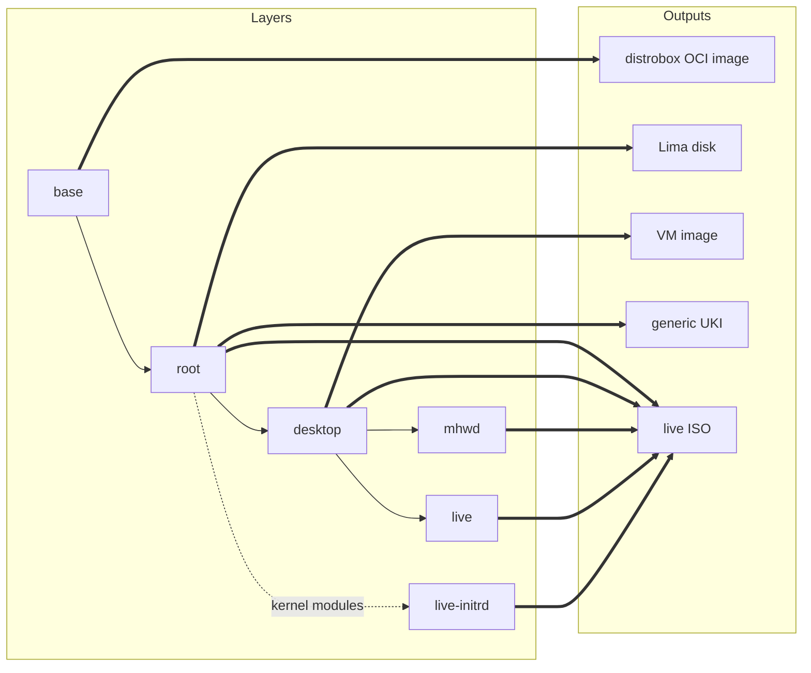
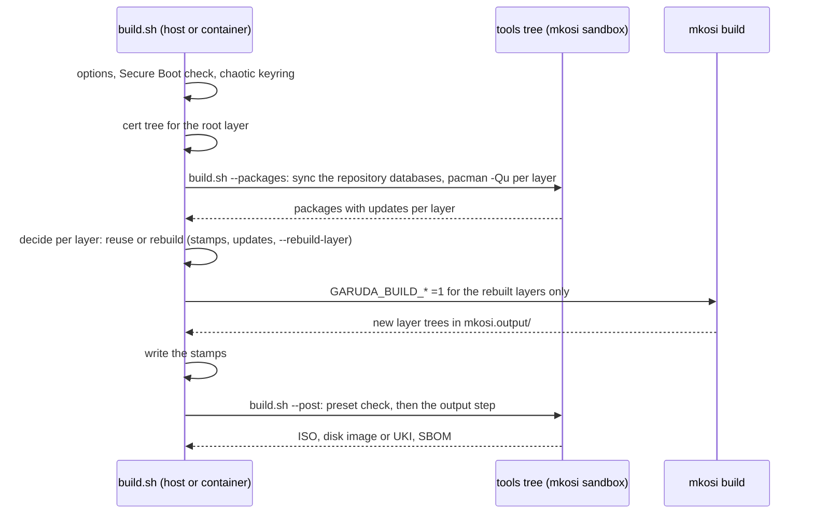
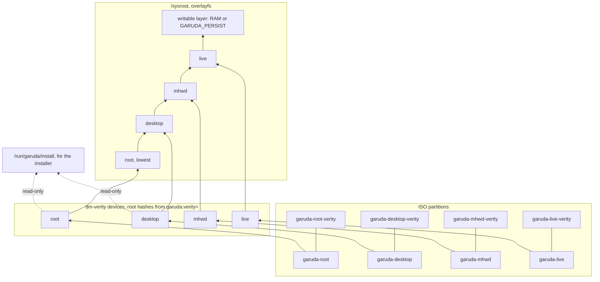
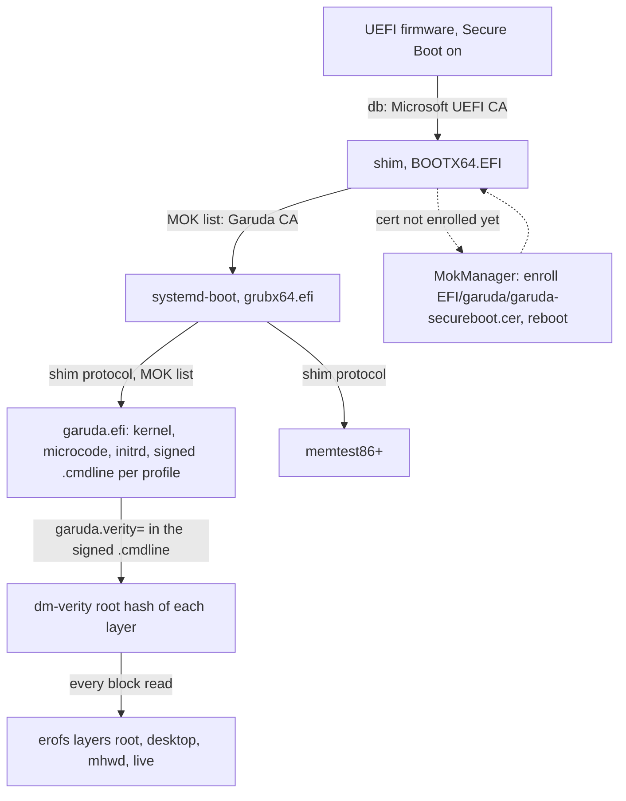

# Architecture

image-builder builds every Garuda image from one set of [mkosi](https://github.com/systemd/mkosi) layers. It replaces garuda-tools _buildiso_ and the [iso-profiles](https://gitlab.com/garuda-linux/tools/iso-profiles), and keeps their model: shared packages and files, plus edition-specific parts.

## Layers

Each layer is an mkosi sub-image in the `mkosi.images/` directory. A layer starts from a full copy of the layer below it (`BaseTrees=`) and installs its own packages on top:

How `build.sh` turns a command into these steps, for example `./build.sh iso mokka`:

The thick arrows show which layers each output is built from.

The layers and the iso-profiles files they replace:

| Layer         | Content                                                    | iso-profiles source                           |
| ------------- | ---------------------------------------------------------- | --------------------------------------------- |
| `base`        | Userland without kernel or boot loader                     | `shared/Packages-Root` (part)                 |
| `root`        | Kernel, firmware, boot loaders, file system and disk tools | `shared/Packages-Root` (part)                 |
| `desktop`     | Shared desktop packages and files, plus the edition        | `Packages-Desktop-Common`, `Packages-Desktop` |
| `live`        | Live session and installer, plus the edition               | `Packages-Live`, `live-overlay-common`        |
| `mhwd`        | Offline driver repository in `/opt/ght/pkg`                | `shared/Packages-Mhwd`                        |
| `live-initrd` | Initrd of the live ISO, a systemd initrd made by mkosi     | the garuda-tools _miso_ dracut module         |

The `base` layer already carries the Garuda repositories `[garuda]`, `[multilib]` and `[chaotic-aur]` in `/etc/pacman.conf`, so the distrobox and Lima images install from them as well. On installs, _garuda-config-agent_ adds them with the `pacman.yaml` rule of _garuda-common-settings_. That package is only part of the `desktop` layer, so `mkosi.postinst.chroot` of `base` applies a copy of the rule once. The record in `/etc/garuda/garuda-config-agent/configs.db` lets _garuda-common-settings_ find the file already done. When _garuda-common-settings_ changes its rule, update the copy in `mkosi.images/base/mkosi.extra/usr/share/image-builder/`.

Every layer is a full tree in `mkosi.output/<layer>/`, where `<layer>` is the layer name. Full trees are used instead of the mkosi option `Overlay=yes`, because `Overlay=yes` drops changed files such as `/etc/passwd` from the layer.

A layer directory can hold:

- `mkosi.conf` and `mkosi.conf.d/`: packages and settings. The `50-extra.conf` files hold the packages that garuda-tools marked `>extra`.
- `mkosi.extra/`: files copied into the layer, including the systemd preset files.
- `mkosi.postinst.chroot`: a script that runs inside the layer after the files are copied. The `root`, `desktop` and `live` layers also run `mkosi.shared/cleanup.chroot` after it, which removes build leftovers such as logs and _.pacnew_ files.
- `mkosi.profiles/<edition>/`: the edition part of the layer, see [Editions](editions.md).

## Outputs

An output is an mkosi profile in the `mkosi.profiles/` directory that picks the layers it needs:

| Output      | Profile                     | Built from      | Result in `mkosi.output/`                   |
| ----------- | --------------------------- | --------------- | ------------------------------------------- |
| `distrobox` | `mkosi.profiles/distrobox/` | `base`          | `garuda-distrobox/`, an OCI image directory |
| `oci`       | `mkosi.profiles/oci/`       | `base`          | `garuda-oci/`, an OCI image directory       |
| `lima`      | `mkosi.profiles/lima/`      | `root`          | `garuda-lima-<version>.qcow2`               |
| `iso`       | `mkosi.profiles/iso/`       | all five layers | `garuda-<edition>-<kernel>-<version>.iso`   |
| `uki`       | `mkosi.profiles/uki/`       | `root`          | `garuda-<kernel>-<version>.efi`, `-eac.efi` |

mkosi builds the layers and the trees of the outputs. `build.sh` does the rest: the Lima disk layout with systemd-boot, the ISO assembly and the OCI layers. It only parses the command line and calls the parts in `lib/`:

| File                | Part                                                           |
| ------------------- | -------------------------------------------------------------- |
| `lib/chaotic.sh`    | chaotic keyring and mirrorlist, signature check                |
| `lib/layers.sh`     | mkosi call, layer stamps and reuse, preset check, SBOM         |
| `lib/disk.sh`       | disk images: btrfs layout, fstab, systemd-boot and UKIs, qcow2 |
| `lib/lima.sh`       | Lima disk on top of `lib/disk.sh`                              |
| `lib/vm.sh`         | VM image of an edition: user, locale, snapshots                |
| `lib/secureboot.sh` | Secure Boot signing, shim download, cert for the root layer    |
| `lib/uki.sh`        | generic UKIs of the root layer, rescue and Easy Anti-Cheat     |
| `lib/iso.sh`        | live ISO: layer diffs, erofs, dm-verity, repart                |
| `lib/container.sh`  | the builder container (`--container`)                          |
| `lib/oci.sh`        | OCI images: `base` as the shared first layer, the rest second  |

## Live ISO

The ISO is a GPT disk image made by _systemd-repart_, as [KDE Linux](https://invent.kde.org/kde-linux/kde-linux) builds its ISO. repart also writes an ISO 9660 header with an El Torito boot catalog that points to the ESP, so the same file boots _systemd-boot_ with UEFI from a USB stick and from a CD drive. There is no BIOS support. `build.sh` assembles it from the layer trees:

1. It computes the difference of each layer to the one below it: new and changed files, and deleted files as overlayfs whiteouts. `root` stays whole, `desktop` is compared with `root`, `mhwd` and `live` with `desktop`.
2. It packs each result as an _erofs_ image and computes its _dm-verity_ hash tree with `veritysetup format`. Salt and UUIDs are derived from the layer name and `SOURCE_DATE_EPOCH`, so the images depend only on their content.
3. It takes the live initrd from the `live-initrd` image. mkosi builds it from its own initrd configuration (`Include=mkosi-initrd`), a plain systemd initrd, with the kernel modules of the `root` layer reduced to the mkosi default set plus what the live ISO needs: `dm-verity`, `loop` and the USB, SD card and ATA drivers.
4. It builds one UKI, `EFI/Linux/garuda.efi`, with kernel, microcode, the live initrd and one profile per boot entry (`ukify --profile`, `--join-profile`). Each profile has its own `.cmdline` with the verity root hash of each layer: open source and proprietary (NVIDIA) drivers, each normal, copied to RAM (`copytoram`) and with persistence, plus an entry that verifies the medium first. Profile 0 (open source drivers) is the default. systemd-boot lists each profile as `Garuda Linux <edition> (<title>)`. _systemd-boot_ reads only FAT, so the UKI goes into a FAT image, the ESP of the ISO, next to the boot loader and _memtest86+_ in `EFI/garuda/`, see [Secure Boot](#secure-boot). The menu has no language, keyboard or time zone choices: the live session and the installer ask for them.
5. _systemd-repart_ writes the image from definitions in `iso-work/repart.d/`: the ESP, then for each layer a partition `garuda-<layer>` with the erofs image and a partition `garuda-<layer>-verity` with its hash tree, all copied with `CopyBlocks=`. The partition types follow the Discoverable Partitions Specification, so that `systemd-dissect` accepts the image, which `systemd-loop@.service` runs before it attaches a CD drive: the `root` layer is the `root` partition with its hash tree as `root-verity`, both read-only, the other layers are `linux-generic` with the no-auto flag (bit 63), which dissect skips. Without the flag, the eight generic partitions would all be root candidates and dissect refuses the image. The live command line has `rd.systemd.gpt_auto=0`, so nothing mounts the root partition on its own. The image is padded to whole 2048-byte sectors, which VirtualBox requires.

| Partition               | Type                     | Content                    |
| ----------------------- | ------------------------ | -------------------------- |
| ESP                     | `esp`                    | `efiboot.img`              |
| `garuda-root`           | `root`, read-only        | erofs image of `root`      |
| `garuda-root-verity`    | `root-verity`, read-only | its dm-verity hash tree    |
| `garuda-<layer>`        | `linux-generic`, no-auto | erofs image of the layer   |
| `garuda-<layer>-verity` | `linux-generic`, no-auto | dm-verity hash tree of it  |
| `GARUDA_PERSIST`        | own type                 | added on the stick at boot |

At boot:

1. _systemd-boot_ shows the profiles of the UKI for 10 seconds and starts it with `garuda.label=<label>` and `garuda.verity=<layer>:<hash>,...`, where `<label>` is the El Torito volume label, for example `GARUDA_MOKKA_20261107`, and `<hash>` the verity root hash of each layer. There is no `root=`: the root file system comes from the initrd's own units.
2. `garuda-live-mount.service` of the initrd (`mkosi.images/live-initrd/mkosi.extra/`) finds the boot disk by its label and the layer partitions on it by their names. The kernel does not read the GPT of a CD drive, which has 2048-byte sectors, so on a CD drive udev starts `systemd-loop@.service` of systemd, which attaches the drive to a loop device with 512-byte sectors and partition scan, and the initrd waits for that loop device. When no disk carries the label, the ISO is a file on another disk, see [ISO file boot](#iso-file-boot).
3. It sets up the writable layer, in RAM or on the persistence partition, copies the layer partitions to RAM when `copytoram` is set, reads every layer once through dm-verity when `checksum` is set, opens each layer as a dm-verity device with its root hash and mounts it read-only under `/run/garuda/layers/<layer>`.
4. `/sysroot` stacks the layers with overlayfs as the root file system, in the order `live`, `mhwd`, `desktop`, `root`, with the writable layer on top.
5. `run-garuda-install.mount` mounts the `desktop` and `root` layers alone at `/run/garuda/install`. The installer copies the new system from there, so the live session and the driver repository do not end up on the installed system.

How the layers become the root file system of the live session:

The `copytoram` option copies the partitions to RAM first, then the initrd opens the same devices from the RAM copy.

### Boot options

The initrd reads these kernel command line options. All but `persistence` work as in the garuda-tools _miso_ module. With Secure Boot off, add them with `e` on an entry of the _systemd-boot_ menu. With Secure Boot on, systemd-stub uses only the signed command line of the profile:

| Option                     | Effect                                                                                                                                                                                                                            |
| -------------------------- | --------------------------------------------------------------------------------------------------------------------------------------------------------------------------------------------------------------------------------- |
| `checksum`                 | reads every layer once through dm-verity before mounting it and stops on a damaged block. Set on the copytoram entries and the "verify the medium" entry.                                                                         |
| `copytoram`                | copies the layer partitions to RAM, so the boot medium can be removed after boot. Needs their size plus 2 GiB free RAM, otherwise it boots from the medium. With `checksum`, the RAM copy is checked, so the medium is read once. |
| `copytoram_size=<size>`    | size of the RAM disk for `copytoram`, default `75%`                                                                                                                                                                               |
| `overlay_root_size=<size>` | size of the writable layer, default `75%`                                                                                                                                                                                         |
| `persistence`              | keeps the writable layer on the persistence partition of the boot stick, see [Persistence](#persistence)                                                                                                                          |
| `persistence=any`          | as `persistence`, but also accepts a persistence partition on another disk                                                                                                                                                        |
| `garuda.verity=<list>`     | the dm-verity root hash of each layer as `<layer>:<hash>`, separated by commas, written by `build.sh`. Every block read from a layer is checked against it. The boot stops when a layer is missing or does not match.             |

`checksum` and `copytoram` also take the form `<option>=y`. `<size>` takes the tmpfs size formats, for example `8G` or `50%`. dm-verity checks every block when it is read, also without `checksum`. `checksum` reads the whole ISO once before the boot, so a damaged medium shows up at once and not later in the session, but booting from a slow medium takes minutes longer. The normal and persistence entries leave it out. The copytoram entries set it, because they read the whole medium anyway and the check then runs on the RAM copy. The last entry of the menu, "verify the medium, then boot", sets it for a normal boot.

`garuda.verity=` only protects as far as the command line itself can be trusted. In a signed build, it is part of the signed UKI, so Secure Boot covers it, see [Secure Boot](#secure-boot). In an unsigned build, it catches damaged or swapped layers, not a medium that was rebuilt on purpose.

### Secure Boot

`build.sh` signs the boot chain of the ISO when `SB_KEY` and `SB_CERT` are set (`lib/secureboot.sh`). Without them, the ISO has the same UKI unsigned, and _systemd-boot_ is `EFI/BOOT/BOOTX64.EFI` directly.

| Variable     | Content                                                                                                                                  |
| ------------ | ---------------------------------------------------------------------------------------------------------------------------------------- |
| `SB_KEY`     | PEM private key file, or a `pkcs11:` URI of a YubiKey or HSM, used through the OpenSSL `pkcs11` provider                                 |
| `SB_CERT`    | PEM certificate of the key, the signing certificate                                                                                      |
| `SB_CA_CERT` | PEM certificate of the CA that issued `SB_CERT`, optional. Machines enroll this one, so the signing key rotates without a new enrollment |

Without `SB_CA_CERT`, machines enroll `SB_CERT` itself. The ESP of a signed ISO:

| Path                               | Content                                                                        |
| ---------------------------------- | ------------------------------------------------------------------------------ |
| `EFI/BOOT/BOOTX64.EFI`             | Fedora's _shim_, signed by the Microsoft UEFI CA, pinned by sha512             |
| `EFI/BOOT/mmx64.efi`               | _MokManager_ from the same package                                             |
| `EFI/BOOT/grubx64.efi`             | _systemd-boot_ of the live tree, signed with `SB_KEY`. _shim_ starts this name |
| `EFI/Linux/garuda.efi`             | the UKI with all boot profiles, signed with `SB_KEY`                           |
| `EFI/garuda/memtest86x64.efi`      | _memtest86+_, signed with `SB_KEY`                                             |
| `EFI/garuda/garuda-secureboot.cer` | the enrollment cert (`SB_CA_CERT`, or `SB_CERT`) in DER form, for _MokManager_ |

The chain from the firmware to every block of the live system:

On the first boot with Secure Boot on, _shim_ does not know the Garuda CA yet and starts _MokManager_. Choose _Enroll key from disk_, pick `EFI/garuda/garuda-secureboot.cer` on the boot medium, confirm and reboot. The CA then stays in the MOK list of the machine, and _shim_ chains the signatures, which name `SB_CERT`, to it. With Secure Boot off, _shim_ starts _systemd-boot_ without checks.

A signed build also puts the enrollment cert into the `root` layer at `/usr/share/garuda/secureboot/garuda-secureboot.crt`, and its hash into the stamp of `root`. `build.sh` checks that `SB_CERT` is issued by `SB_CA_CERT` and that `SB_KEY` belongs to `SB_CERT`, on the host when it has `openssl` and again in the post-build steps, which also check every signature with `sbverify`. A `pkcs11:` key works only for builds on the host, not in the builder container.

> [!NOTE]
> Installed systems build their UKIs on the machine, so the Garuda key cannot sign them, and their normal entries do not boot with Secure Boot on. The [generic UKIs](building.md#generic-uki) are the signed base for the rescue and Easy Anti-Cheat entries that do. Installed systems are planned to enroll the Garuda CA into the firmware `db` with _sbctl_ instead of the MOK list, so that chain starts at the firmware without _shim_.

### ISO file boot

Boot managers such as [Ventoy](https://www.ventoy.net) keep the ISO as a file on their own partition and start it through a virtual CD drive of the firmware, which Linux does not see. Ventoy usually adds a hook to the initrd of the ISO, which is not possible here: the initrd is part of the UKI, which is signed in a signed build. Instead, `garuda-live-mount` looks for the file itself. Within the 90 seconds it waits for the medium, it tries each second:

1. the disk with the volume label, as written with _dd_ or on a CD drive,
2. the EFI variable `VentoyOsParam` that Ventoy leaves for the booted system, with the disk, partition and path of the ISO file (`ventoy_os_param` in `VtoyTool/vtoytool.h` of Ventoy),
3. from 10 seconds on and every 10 seconds, a search on USB sticks and SD cards: every file system, read-only, for `*.iso` files down to two directories deep. It covers Ventoy in memdisk mode, GRUB loopback and similar setups. Internal disks are not searched.

The file system is mounted read-only at `/run/garuda/image-fs`, without journal replay, and the ISO file attached to a read-only loop device with partition scan. The file must carry the volume label, and the layers must match `garuda.verity=` as on a written stick, so an ISO file of another build does not boot. The file systems are those of Ventoy's data partition: exFAT, NTFS, ext4, XFS, UDF and FAT. Ventoy's own initrd hook maps the extents of the file with device-mapper from `/dev/mem` instead, which kernel lockdown blocks under Secure Boot.

The file system stays mounted for the session, as the loop device holds the file. Persistence needs the ISO written to the stick, and copytoram does not free the stick.

### Persistence

With the `persistence` boot option, changes made in the live session survive a reboot. The initrd keeps the writable layer on an ext4 partition labelled `GARUDA_PERSIST` on the USB stick it was booted from. A partition with that label on another disk is ignored, so a disk plugged in by someone else cannot replace the live system. To use a partition on another disk, boot with `persistence=any`. Each ISO keeps its state in a directory named after its volume label, so a new version starts clean. The initrd removes nothing: at boot it lists the directories of other images with their sizes, remove them by hand to free space.

When no such partition exists, the initrd creates one on the first boot with `persistence`: _systemd-repart_ adds it from `/usr/lib/garuda-live/repart.d/` in the free space behind the ISO on the USB stick it was booted from, filling the rest of the stick, and formats it. It needs at least 1 GiB of free space. The partition has its own type, so repart does not mistake it for a layer partition, and repart keeps the partitions of the ISO as they are. The initrd only changes a disk whose own volume label is the label of this ISO, so it does not touch other disks, and it never acts on a CD drive. To use another disk, create an ext4 partition labelled `GARUDA_PERSIST` there yourself and boot with `persistence=any`.

The partition holds one directory per ISO label. A new ISO version therefore starts with a clean state, and the changes made with older versions stay on the partition until they are deleted.

> [!WARNING]
> The first boot with `persistence` writes a new partition table entry to the USB stick. Writing the ISO to the stick again removes the partition and everything on it.

## Settings from garuda-tools

The garuda-tools settings and their replacements:

| garuda-tools                             | image-builder                                               |
| ---------------------------------------- | ----------------------------------------------------------- |
| `garuda-tools.conf`                      | `mkosi.conf`, overridden by `mkosi.local.conf`              |
| `kernel`                                 | `Environment=KERNEL=` or `-E KERNEL=<kernel>`               |
| `kernel` in an edition                   | `EDITION_KERNEL` in `lib/iso.sh`                            |
| `build_mirror`                           | `mkosi.sandbox/etc/pacman.d/mirrorlist`                     |
| `dist_branding`                          | `ImageId=`                                                  |
| `dist_timestamp`                         | `VERSION` environment variable, default today as `YYYYMMDD` |
| `extra=false`                            | `[Match] Profiles=!kde-lite` in the `50-extra.conf` files   |
| `enable_systemd`, `disable_systemd`      | systemd preset files                                        |
| `configure_calamares`                    | static files, see [Installer](installer.md)                 |
| build-time fixes (`clean_up_image` etc.) | `mkosi.postinst.chroot` of the `root` and `desktop` layers  |

## Pacman keyring

The images ship no pacman keyring. A keyring made at build time would give every machine made from an image the same private master key, and anyone with the image could certify keys that all of these machines trust. Each system makes its own keyring instead:

| System                        | Keyring made by                                          |
| ----------------------------- | -------------------------------------------------------- |
| Lima, VM image                | `pacman-init.service` on the first boot                  |
| distrobox, also with `--init` | the `--pre-init-hooks` option at box creation            |
| live ISO                      | `garuda-live-keyring.service`                            |
| installed system              | the Calamares _postcfg_ module                           |
| `oci` image                   | `mkosi.profiles/oci/mkosi.postinst.chroot` at build time |

On the first start of a box, `distrobox-init` runs _pacman_ before systemd starts, also with `--init`, so `pacman-init.service` comes too late for it.

The `oci` image is the exception, like the Arch Linux image: `podman run` and `docker run` have no first boot that could make a keyring. Every container of one build shares its private master key, and the second layer of the image differs on every build. `repro-check` does not build it.

The driver repository in `/opt/ght/pkg` needs no keyring. `mkosi.postinst.chroot` of the `mhwd` layer checks the signatures of the driver packages when it downloads them, with a temporary keyring that it removes afterwards. On the ISO the repository is part of the dm-verity protected `mhwd` layer, so `/opt/ght/pacman-ght.conf` has `SigLevel = Never` for it, and `ght-live.service` installs the drivers before `garuda-live-keyring.service` makes the system keyring. A keyring kept in the layer would hold a new private master key on every build, and the ISO would differ between builds.

## DNS

Every image resolves names with _systemd-resolved_. The `mkosi.extra/` of the `base` layer sets it up:

| File                                          | Purpose                                                                                   |
| --------------------------------------------- | ----------------------------------------------------------------------------------------- |
| `/etc/resolv.conf`                            | link to `../run/systemd/resolve/stub-resolv.conf`, replaces the plain file of the package |
| `/etc/systemd/resolved.conf.d/50-garuda.conf` | Quad9 as the only fallback server, `DNSOverTLS=opportunistic`, `MulticastDNS=no`          |

The link cannot be made in `mkosi.postinst.chroot`: with `WithNetwork=yes`, mkosi mounts the host's `/etc/resolv.conf` over it in the chroot, and `ln` fails with "Device or resource busy". On a link, mkosi mounts on top of the link without following it, so the later layers keep it.

NetworkManager sees the stub link and hands the DNS servers of each connection to _systemd-resolved_, so the servers of the network stay primary. Quad9 is only asked when the network gives none. DNS over TLS is used where the server supports it, plain DNS otherwise. Arch's `90-systemd.preset` enables `systemd-resolved.service`, and `80-garuda-desktop.preset` leaves it enabled.

mDNS stays with _avahi_ and `nss-mdns` (`mdns_minimal` in `/etc/nsswitch.conf`). Two mDNS stacks on port 5353 make mDNS unreliable, so _systemd-resolved_ does not run its own.

The Calamares _networkcfg_ module copies the link from the live session to the installed system.

## systemd-boot

New installs and the Lima image boot _systemd-boot_ with one unified kernel image (UKI) per kernel, and carry no GRUB. The live ISO boots _systemd-boot_ with a plain kernel and initrd. The parts come from two packages, `garuda-systemd-boot` and `snapper-support-sdboot`, which only new installs get. Every part does nothing as long as `bootctl is-installed` fails, so a GRUB system that installs them keeps booting as before. Existing GRUB installs keep their GRUB packages and `snapper-support`.

### Kernel UKIs

The `root` layer installs `garuda-systemd-boot`, the _kernel-install_ configuration and its hooks:

| File                                                            | Purpose                                                                                                        |
| --------------------------------------------------------------- | -------------------------------------------------------------------------------------------------------------- |
| `/etc/kernel/install.conf`                                      | `layout=uki`, the UKI is built by _ukify_                                                                      |
| `/etc/kernel/tries`                                             | `3`, boot counting: an entry that fails three boots in a row sorts last                                        |
| `/etc/kernel/uki.conf`                                          | _ukify_ settings, the place for Secure Boot signing keys later                                                 |
| `/usr/lib/kernel/install.d/95-garuda-fallback.install`          | a second UKI per kernel with the no-hostonly `initramfs-<pkgbase>-fallback.img`, titled "(fallback initramfs)" |
| `/usr/share/libalpm/hooks/95-garuda-kernel-install.hook`        | after `90-dracut-install.hook`, runs `/usr/lib/garuda/kernel-install-uki add` for every installed kernel       |
| `/usr/share/libalpm/hooks/61-garuda-kernel-install-remove.hook` | runs `kernel-install remove` for a removed kernel                                                              |
| `/usr/lib/systemd/system-preset/80-garuda-systemd-boot.preset`  | enables `systemd-boot-update.service`, which updates _systemd-boot_ on the ESP after a _systemd_ update        |

`garuda-boot-check.service` (`desktop` layer) holds back `boot-complete.target` until the display manager runs, so a boot without a display manager counts as a failed try. On a counted boot it also starts the display manager when the default target is `multi-user.target`. Installs without a display manager, for example with a TTY login, must run `systemctl disable garuda-boot-check.service`. Otherwise every new UKI sorts last after three boots. See [Automatic Boot Assessment](https://systemd.io/AUTOMATIC_BOOT_ASSESSMENT/).

`kernel-install-uki` passes the initramfs that `dracut-install-garuda` built in `/boot` to `kernel-install`, so dracut runs once per update. The kernel command line comes from `/etc/kernel/cmdline`. The UKIs land in `EFI/Linux/` on the ESP, where _systemd-boot_ finds them on its own.

### Snapshot entries

The `desktop` layer installs `snapper-support-sdboot` with `snapper-sdboot`. It gives every snapper snapshot of `/` its own boot entry, except the `post` snapshots of _snap-pac_:

1. The snapper plugin `/usr/lib/snapper/plugins/50-snapper-sdboot` starts `snapper-sdboot.service` after a snapshot is created, changed or deleted.
2. `snapper-sdboot sync` groups the snapshots by kernel version and initramfs. Each group shares one multi-profile UKI `EFI/snapper-sdboot/<pkgbase>-<version>-<initramfs hash>/snapshots.efi`, built from the kernel and initramfs in the snapshots' `/boot`. Every snapshot is one profile of it, with the snapshot's own `/etc/kernel/cmdline` plus `rootflags=subvol=@/.snapshots/<number>/snapshot`. btrfs uses the last `subvol=`, so the snapshot is mounted. The `50btrfs-snapshot-overlay` dracut module makes the read-only snapshot writable in RAM.
3. A Type 1 entry `loader/entries/snapper-sdboot-<number>.conf` points at the UKI and selects the snapshot's profile with `profile <n>`. Its sort key `snapper-sdboot` puts the snapshots below the normal entries, the newest first.

The installer adds a permanent snapshot "Fresh install", see [Installer#Installation process](installer.md#installation-process).

The snapshot UKIs live outside `EFI/Linux/`, so _systemd-boot_ does not list them twice and _kernel-install_ does not remove them with their kernel. A UKI holds at most 60 profiles (the PE header space of _systemd-stub_), so a kernel version keeps entries for its newest 60 snapshots. A new snapshot rebuilds the UKI of its group, about 8 s with 60 profiles. When the ESP would fall under `FREE_SPACE_FLOOR_MIB` (512 MiB) of free space, the oldest snapshot entries are left out. `/etc/snapper-sdboot.conf` sets the floor and the skipped snapshot types. `snapper-sdboot list` prints the snapshot entries. The ESP is readable by root only, so the command runs itself through _sudo_ for other users. A system booted from a snapshot does not change the entries.

## See also

- [Building](building.md)
- [Editions](editions.md)
- [mkosi documentation](https://github.com/systemd/mkosi/blob/main/mkosi/resources/man/mkosi.1.md)
- [KDE Linux](https://invent.kde.org/kde-linux/kde-linux), the reference for the layer layout
- [archiso](https://gitlab.archlinux.org/archlinux/archiso), the reference for the hybrid ISO
