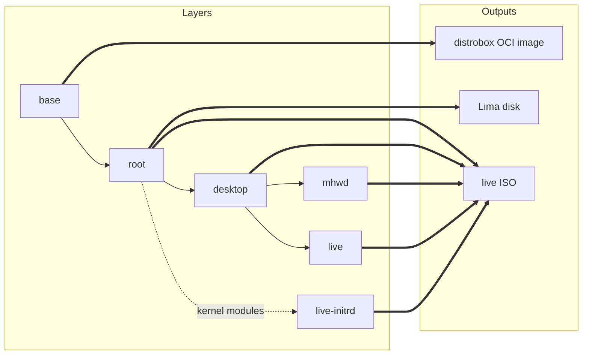

# Architecture

image-builder builds every Garuda image from one set of [mkosi](https://github.com/systemd/mkosi) layers. It replaces garuda-tools _buildiso_ and the [iso-profiles](https://gitlab.com/garuda-linux/tools/iso-profiles), and keeps their model: shared packages and files, plus edition-specific parts.

## Layers

Each layer is an mkosi sub-image in the `mkosi.images/` directory. A layer starts from a full copy of the layer below it (`BaseTrees=`) and installs its own packages on top:

The thick arrows show which layers each output is built from.

The layers and the iso-profiles files they replace:

| Layer         | Content                                                    | iso-profiles source                           |
| ------------- | ---------------------------------------------------------- | --------------------------------------------- |
| `base`        | Userland without kernel or boot loader                     | `shared/Packages-Root` (part)                 |
| `root`        | Kernel, firmware, boot loaders, file system and disk tools | `shared/Packages-Root` (part)                 |
| `desktop`     | Shared desktop packages and files, plus the edition        | `Packages-Desktop-Common`, `Packages-Desktop` |
| `live`        | Live session and installer, plus the edition               | `Packages-Live`, `live-overlay-common`        |
| `mhwd`        | Offline driver repository in `/opt/ght/pkg`                | `shared/Packages-Mhwd`                        |
| `live-initrd` | Initrd of the live ISO, a systemd initrd made by mkosi     | the garuda-tools _miso_ dracut module         |

The `base` layer already carries the Garuda repositories `[garuda]`, `[multilib]` and `[chaotic-aur]` in `/etc/pacman.conf`, so the distrobox and Lima images install from them as well. On installs, _garuda-config-agent_ adds them with the `pacman.yaml` rule of _garuda-common-settings_. That package is only part of the `desktop` layer, so `mkosi.postinst.chroot` of `base` applies a copy of the rule once. The record in `/etc/garuda/garuda-config-agent/configs.db` lets _garuda-common-settings_ find the file already done. When _garuda-common-settings_ changes its rule, update the copy in `mkosi.images/base/mkosi.extra/usr/share/image-builder/`.

Every layer is a full tree in `mkosi.output/<layer>/`, where `<layer>` is the layer name. Full trees are used instead of the mkosi option `Overlay=yes`, because `Overlay=yes` drops changed files such as `/etc/passwd` from the layer.

A layer directory can hold:

- `mkosi.conf` and `mkosi.conf.d/`: packages and settings. The `50-extra.conf` files hold the packages that garuda-tools marked `>extra`.
- `mkosi.extra/`: files copied into the layer, including the systemd preset files.
- `mkosi.postinst.chroot`: a script that runs inside the layer after the files are copied. The `root`, `desktop` and `live` layers also run `mkosi.shared/cleanup.chroot` after it, which removes build leftovers such as logs and _.pacnew_ files.
- `mkosi.profiles/<edition>/`: the edition part of the layer, see [Editions](editions.md).

## Outputs

An output is an mkosi profile in the `mkosi.profiles/` directory that picks the layers it needs:

| Output      | Profile                     | Built from      | Result in `mkosi.output/`                   |
| ----------- | --------------------------- | --------------- | ------------------------------------------- |
| `distrobox` | `mkosi.profiles/distrobox/` | `base`          | `garuda-distrobox/`, an OCI image directory |
| `lima`      | `mkosi.profiles/lima/`      | `root`          | `garuda-lima-<version>.qcow2`               |
| `iso`       | `mkosi.profiles/iso/`       | all five layers | `garuda-<edition>-<kernel>-<version>.iso`   |

mkosi builds the layers and the distrobox image. `build.sh` does the rest: the Lima disk layout with systemd-boot, and the ISO assembly. It only parses the command line and calls the parts in `lib/`:

| File               | Part                                                           |
| ------------------ | -------------------------------------------------------------- |
| `lib/chaotic.sh`   | chaotic keyring and mirrorlist, signature check                |
| `lib/layers.sh`    | mkosi call, layer stamps and reuse, preset check, SBOM         |
| `lib/disk.sh`      | disk images: btrfs layout, fstab, systemd-boot and UKIs, qcow2 |
| `lib/lima.sh`      | Lima disk on top of `lib/disk.sh`                              |
| `lib/vm.sh`        | VM image of an edition: user, locale, snapshots                |
| `lib/iso.sh`       | live ISO: layer diffs, erofs, dm-verity, repart                |
| `lib/container.sh` | the builder container (`--container`)                          |

## Live ISO

The ISO is a GPT disk image made by _systemd-repart_, as [KDE Linux](https://invent.kde.org/kde-linux/kde-linux) builds its ISO. repart also writes an ISO 9660 header with an El Torito boot catalog that points to the ESP, so the same file boots _systemd-boot_ with UEFI from a USB stick and from a CD drive. There is no BIOS support. `build.sh` assembles it from the layer trees:

1. It computes the difference of each layer to the one below it: new and changed files, and deleted files as overlayfs whiteouts. `root` stays whole, `desktop` is compared with `root`, `mhwd` and `live` with `desktop`.
2. It packs each result as an _erofs_ image and computes its _dm-verity_ hash tree with `veritysetup format`. Salt and UUIDs are derived from the layer name and `SOURCE_DATE_EPOCH`, so the images depend only on their content.
3. It takes the live initrd from the `live-initrd` image. mkosi builds it from its own initrd configuration (`Include=mkosi-initrd`), a plain systemd initrd, with the kernel modules of the `root` layer reduced to the mkosi default set plus what the live ISO needs: `dm-verity`, `loop` and the USB, SD card and ATA drivers. _systemd-boot_ reads only FAT, so kernel, initrd and microcode go into a FAT image, the ESP of the ISO, in `/garuda/` (`vmlinuz-x86_64`, `initramfs-x86_64.img`, `intel-ucode.img`, `amd-ucode.img`), next to _systemd-boot_ from the live tree as `EFI/BOOT/BOOTX64.EFI`.
4. It writes the boot menu into the ESP image: six Type 1 entries in `loader/entries/`, open source and proprietary (NVIDIA) drivers, each normal, copied to RAM (`copytoram`) and with persistence, plus _memtest86+_ and the firmware setup. The entries carry the verity root hash of each layer. The menu has no language, keyboard or time zone choices: the live session and the installer ask for them.
5. _systemd-repart_ writes the image from definitions in `iso-work/repart.d/`: the ESP, then for each layer a partition `garuda-<layer>` with the erofs image and a partition `garuda-<layer>-verity` with its hash tree, all copied with `CopyBlocks=`. The partition types follow the Discoverable Partitions Specification, so that `systemd-dissect` accepts the image, which `systemd-loop@.service` runs before it attaches a CD drive: the `root` layer is the `root` partition with its hash tree as `root-verity`, both read-only, the other layers are `linux-generic` with the no-auto flag (bit 63), which dissect skips. Without the flag, the eight generic partitions would all be root candidates and dissect refuses the image. The live command line has `rd.systemd.gpt_auto=0`, so nothing mounts the root partition on its own. The image is padded to whole 2048-byte sectors, which VirtualBox requires.

| Partition               | Type                     | Content                    |
| ----------------------- | ------------------------ | -------------------------- |
| ESP                     | `esp`                    | `efiboot.img`              |
| `garuda-root`           | `root`, read-only        | erofs image of `root`      |
| `garuda-root-verity`    | `root-verity`, read-only | its dm-verity hash tree    |
| `garuda-<layer>`        | `linux-generic`, no-auto | erofs image of the layer   |
| `garuda-<layer>-verity` | `linux-generic`, no-auto | dm-verity hash tree of it  |
| `GARUDA_PERSIST`        | own type                 | added on the stick at boot |

At boot:

1. _systemd-boot_ shows the entries of the ESP for 10 seconds and starts the kernel with `garuda.label=<label>` and `garuda.verity=<layer>:<hash>,...`, where `<label>` is the El Torito volume label, for example `GARUDA_MOKKA_20261107`, and `<hash>` the verity root hash of each layer. There is no `root=`: the root file system comes from the initrd's own units.
2. `garuda-live-mount.service` of the initrd (`mkosi.images/live-initrd/mkosi.extra/`) finds the boot disk by its label and the layer partitions on it by their names. The kernel does not read the GPT of a CD drive, which has 2048-byte sectors, so on a CD drive udev starts `systemd-loop@.service` of systemd, which attaches the drive to a loop device with 512-byte sectors and partition scan, and the initrd waits for that loop device.
3. It sets up the writable layer, in RAM or on the persistence partition, copies the layer partitions to RAM when `copytoram` is set, reads every layer once through dm-verity when `checksum` is set, opens each layer as a dm-verity device with its root hash and mounts it read-only under `/run/garuda/layers/<layer>`.
4. `/sysroot` stacks the layers with overlayfs as the root file system, in the order `live`, `mhwd`, `desktop`, `root`, with the writable layer on top.
5. `run-garuda-install.mount` mounts the `desktop` and `root` layers alone at `/run/garuda/install`. The installer copies the new system from there, so the live session and the driver repository do not end up on the installed system.

### Boot options

The initrd reads these kernel command line options. All but `persistence` work as in the garuda-tools _miso_ module. Add them with `e` on a boot entry of the _systemd-boot_ menu:

| Option                     | Effect                                                                                                                                                                                                                            |
| -------------------------- | --------------------------------------------------------------------------------------------------------------------------------------------------------------------------------------------------------------------------------- |
| `checksum`                 | reads every layer once through dm-verity before mounting it and stops on a damaged block. On by default.                                                                                                                          |
| `copytoram`                | copies the layer partitions to RAM, so the boot medium can be removed after boot. Needs their size plus 2 GiB free RAM, otherwise it boots from the medium. With `checksum`, the RAM copy is checked, so the medium is read once. |
| `copytoram_size=<size>`    | size of the RAM disk for `copytoram`, default `75%`                                                                                                                                                                               |
| `overlay_root_size=<size>` | size of the writable layer, default `75%`                                                                                                                                                                                         |
| `persistence`              | keeps the writable layer on the persistence partition of the boot stick, see [Persistence](#persistence)                                                                                                                          |
| `persistence=any`          | as `persistence`, but also accepts a persistence partition on another disk                                                                                                                                                        |
| `garuda.verity=<list>`     | the dm-verity root hash of each layer as `<layer>:<hash>`, separated by commas, written by `build.sh`. Every block read from a layer is checked against it. The boot stops when a layer is missing or does not match.             |

`checksum` and `copytoram` also take the form `<option>=y`. `<size>` takes the tmpfs size formats, for example `8G` or `50%`. dm-verity checks every block when it is read, also without `checksum`. `checksum` reads the whole ISO once before the boot, so a damaged medium shows up at once and not later in the session, but booting from a slow medium takes longer. Remove `checksum=y` from the boot entry to skip it.

`garuda.verity=` only protects as far as the boot entry itself can be trusted: it sits in a boot entry on the same medium. Without Secure Boot and signed boot entries, it catches damaged or swapped layers, not a medium that was rebuilt on purpose.

### Persistence

With the `persistence` boot option, changes made in the live session survive a reboot. The initrd keeps the writable layer on an ext4 partition labelled `GARUDA_PERSIST` on the USB stick it was booted from. A partition with that label on another disk is ignored, so a disk plugged in by someone else cannot replace the live system. To use a partition on another disk, boot with `persistence=any`.

When no such partition exists, the initrd creates one on the first boot with `persistence`: _systemd-repart_ adds it from `/usr/lib/garuda-live/repart.d/` in the free space behind the ISO on the USB stick it was booted from, filling the rest of the stick, and formats it. It needs at least 1 GiB of free space. The partition has its own type, so repart does not mistake it for a layer partition, and repart keeps the partitions of the ISO as they are. The initrd only changes a disk whose own volume label is the label of this ISO, so it does not touch other disks, and it never acts on a CD drive. To use another disk, create an ext4 partition labelled `GARUDA_PERSIST` there yourself and boot with `persistence=any`.

The partition holds one directory per ISO label. A new ISO version therefore starts with a clean state, and the changes made with older versions stay on the partition until they are deleted.

> [!WARNING]
> The first boot with `persistence` writes a new partition table entry to the USB stick. Writing the ISO to the stick again removes the partition and everything on it.

## Settings from garuda-tools

The garuda-tools settings and their replacements:

| garuda-tools                             | image-builder                                               |
| ---------------------------------------- | ----------------------------------------------------------- |
| `garuda-tools.conf`                      | `mkosi.conf`, overridden by `mkosi.local.conf`              |
| `kernel`                                 | `Environment=KERNEL=` or `-E KERNEL=<kernel>`               |
| `kernel` in an edition                   | `EDITION_KERNEL` in `lib/iso.sh`                            |
| `build_mirror`                           | `mkosi.sandbox/etc/pacman.d/mirrorlist`                     |
| `dist_branding`                          | `ImageId=`                                                  |
| `dist_timestamp`                         | `VERSION` environment variable, default today as `YYYYMMDD` |
| `extra=false`                            | `[Match] Profiles=!kde-lite` in the `50-extra.conf` files   |
| `enable_systemd`, `disable_systemd`      | systemd preset files                                        |
| `configure_calamares`                    | static files, see [Installer](installer.md)                 |
| build-time fixes (`clean_up_image` etc.) | `mkosi.postinst.chroot` of the `root` and `desktop` layers  |

## Pacman keyring

The images ship no pacman keyring. A keyring made at build time would give every machine made from an image the same private master key, and anyone with the image could certify keys that all of these machines trust. Each system makes its own keyring instead:

| System                   | Keyring made by                               |
| ------------------------ | --------------------------------------------- |
| Lima, distrobox `--init` | `pacman-init.service` on the first boot       |
| distrobox                | the `--pre-init-hooks` option at box creation |
| live ISO                 | `garuda-live-keyring.service`                 |
| installed system         | the Calamares _postcfg_ module                |

The one exception is the keyring of the driver repository in `/opt/ght/gnupg`, made by `mkosi.postinst.chroot` of the `mhwd` layer and set as `GPGDir=` in `/opt/ght/pacman-ght.conf`. The live ISO installs the drivers with `ght-live.service` before `garuda-live-keyring.service` makes the system keyring, so the driver packages are checked against this keyring (`SigLevel = Required DatabaseOptional`). It is the same on every ISO, but pacman uses it only for the packages of `/opt/ght/pkg`.

## systemd-boot

New installs and the Lima image boot _systemd-boot_ with one unified kernel image (UKI) per kernel, and carry no GRUB. The live ISO boots _systemd-boot_ with a plain kernel and initrd. The parts come from two packages, `garuda-systemd-boot` and `snapper-support-sdboot`, which only new installs get. Every part does nothing as long as `bootctl is-installed` fails, so a GRUB system that installs them keeps booting as before. Existing GRUB installs keep their GRUB packages and `snapper-support`.

### Kernel UKIs

The `root` layer installs `garuda-systemd-boot`, the _kernel-install_ configuration and its hooks:

| File                                                            | Purpose                                                                                                        |
| --------------------------------------------------------------- | -------------------------------------------------------------------------------------------------------------- |
| `/etc/kernel/install.conf`                                      | `layout=uki`, the UKI is built by _ukify_                                                                      |
| `/etc/kernel/tries`                                             | `3`, boot counting: an entry that fails three boots in a row sorts last                                        |
| `/etc/kernel/uki.conf`                                          | _ukify_ settings, the place for Secure Boot signing keys later                                                 |
| `/usr/lib/kernel/install.d/95-garuda-fallback.install`          | a second UKI per kernel with the no-hostonly `initramfs-<pkgbase>-fallback.img`, titled "(fallback initramfs)" |
| `/usr/share/libalpm/hooks/95-garuda-kernel-install.hook`        | after `90-dracut-install.hook`, runs `/usr/lib/garuda/kernel-install-uki add` for every installed kernel       |
| `/usr/share/libalpm/hooks/61-garuda-kernel-install-remove.hook` | runs `kernel-install remove` for a removed kernel                                                              |
| `/usr/lib/systemd/system-preset/80-garuda-systemd-boot.preset`  | enables `systemd-boot-update.service`, which updates _systemd-boot_ on the ESP after a _systemd_ update        |

`kernel-install-uki` passes the initramfs that `dracut-install-garuda` built in `/boot` to `kernel-install`, so dracut runs once per update. The kernel command line comes from `/etc/kernel/cmdline`. The UKIs land in `EFI/Linux/` on the ESP, where _systemd-boot_ finds them on its own.

### Snapshot entries

The `desktop` layer installs `snapper-support-sdboot` with `snapper-sdboot`. It gives every snapper snapshot of `/` its own boot entry, except the `post` snapshots of _snap-pac_:

1. The snapper plugin `/usr/lib/snapper/plugins/50-snapper-sdboot` starts `snapper-sdboot.service` after a snapshot is created, changed or deleted.
2. `snapper-sdboot sync` builds a UKI from the snapshot's own kernel, initramfs and `/etc/kernel/cmdline` in `EFI/snapper-sdboot/<number>/snapshot.efi`, and a cmdline addon `snapshot.efi.extra.d/snapshot.addon.efi` with `rootflags=subvol=@/.snapshots/<number>/snapshot`. _systemd-stub_ appends the addon to the command line of the UKI, and btrfs uses the last `subvol=`, so the snapshot is mounted. The `50btrfs-snapshot-overlay` dracut module makes the read-only snapshot writable in RAM.
3. A Type 1 entry `loader/entries/snapper-sdboot-<number>.conf` points at the UKI. Its sort key `snapper-sdboot` puts the snapshots below the normal entries, the newest first.

The snapshot UKIs live outside `EFI/Linux/`, so _systemd-boot_ does not list them twice and _kernel-install_ does not remove them with their kernel. When the ESP would fall under `FREE_SPACE_FLOOR_MIB` (512 MiB) of free space, the oldest snapshot entries are left out. `/etc/snapper-sdboot.conf` sets the floor and the skipped snapshot types. `snapper-sdboot list` prints the snapshot entries. The ESP is readable by root only, so the command runs itself through _sudo_ for other users. A system booted from a snapshot does not change the entries.

## See also

- [Building](building.md)
- [Editions](editions.md)
- [mkosi documentation](https://github.com/systemd/mkosi/blob/main/mkosi/resources/man/mkosi.1.md)
- [KDE Linux](https://invent.kde.org/kde-linux/kde-linux), the reference for the layer layout
- [archiso](https://gitlab.archlinux.org/archlinux/archiso), the reference for the hybrid ISO
