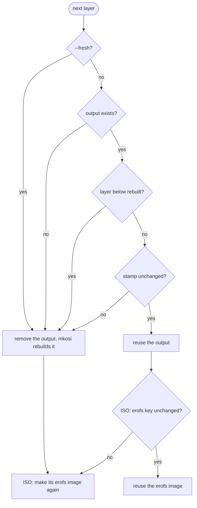

# Building

All builds go through `build.sh`. It runs [mkosi](https://github.com/systemd/mkosi) with the right profiles, then finishes the Lima disk or assembles the ISO.

## Installation

The development shell provides the build and test commands. Enter it with `nix develop`, or allow the `.envrc` file with [direnv](https://direnv.net/). The shell also installs the pre-commit hooks.

Each command runs a script of the `scripts/` directory in the checkout, so changes to a script apply without entering the shell again:

| Command          | Purpose                                                                                                            |
| ---------------- | ------------------------------------------------------------------------------------------------------------------ |
| `build`          | runs `./build.sh --container` as root with the given arguments                                                     |
| `boot-check`     | boots an image with _systemd-nspawn_, see [Testing](testing.md)                                                    |
| `distrobox-test` | creates a box from the built image and checks it                                                                   |
| `lima-test`      | boots the Lima image and checks it                                                                                 |
| `iso-test`       | boots a live ISO in QEMU                                                                                           |
| `lint`           | runs the pre-commit hooks, _shellcheck_, _shfmt_, _ruff_, _yamllint_ and a mkosi check of every output and edition |
| `manifest-diff`  | lists the package changes between two builds                                                                       |
| `sbom`           | writes the SPDX SBOM of a package manifest, see [SBOM](#sbom)                                                      |

_podman_ and _distrobox_ come from the host system, because rootless podman needs the `newuidmap` wrappers of the system.

To build without the development shell, install the `mkosi` package (version 27 or later) on an Arch-based host. The other build tools come from the mkosi tools tree, see [Tools tree](#tools-tree). The host also needs `curl`, `gnupg`, `git` and `zstd` for the chaotic keyring and the build time stamp. All builds need root, because mkosi, loop devices and the mounts of the Lima disk need it.

On hosts without the Arch tools, such as NixOS, build inside the builder container, see [Builder container](#builder-container).

## Configuration

### Local settings

To change settings only on this machine, copy `mkosi.local.conf.example` to `mkosi.local.conf`, for example to set another kernel or `Incremental=no`. Git ignores the file. Options on the command line win over it, and it wins over `mkosi.conf`.

### Repositories

The build repositories are in `mkosi.sandbox/etc/pacman.conf`, in the Garuda order: _garuda_, _core_, _extra_, _multilib_, _chaotic-aur_. The mirror is in `mkosi.sandbox/etc/pacman.d/mirrorlist`. mkosi ignores its `Mirror=` setting when this file exists.

`build.sh` downloads the chaotic keyring and mirrorlist into `mkosi.sandbox/` on the first run, because they are not in the Arch repositories. Git ignores them. Before it uses them, it checks their package signatures against the chaotic-aur signing key, whose fingerprint is pinned as `CHAOTIC_KEY` in `lib/chaotic.sh`. The public key itself is vendored as `ci/chaotic-key.asc`, so the build needs no keyserver.

## Usage

Give `build.sh` the output and, for an ISO or a VM image, the edition:

```console
# ./build.sh distrobox
# ./build.sh lima
# ./build.sh iso mokka
# ./build.sh vm mokka
```

In the development shell, `build` runs the same in the builder container:

```console
$ build iso dr460nized
```

Arguments after the output and the edition go to mkosi unchanged. For example, to build with another kernel:

```console
# ./build.sh lima -E KERNEL=linux-lts
```

Supported kernels have a `mkosi.images/root/mkosi.conf.d/kernel-<kernel>.conf` file. The build stops with an error for any other value.

### Options

Options go before the output name:

| Option              | Effect                                                        |
| ------------------- | ------------------------------------------------------------- |
| `--fresh`           | rebuilds every layer and installs all packages again          |
| `--refresh-keys`    | downloads the chaotic keyring and mirrorlist again            |
| `--container`       | runs the build in the builder container                       |
| `--rebuild-builder` | builds the builder container image again (with `--container`) |

### Results

The results are in the `mkosi.output/` directory:

| File                                                   | Content                                                                    |
| ------------------------------------------------------ | -------------------------------------------------------------------------- |
| `garuda-distrobox/`                                    | OCI image directory with _zstd_ layers                                     |
| `garuda-lima-<version>.qcow2`                          | disk image, systemd-boot with UKIs (UEFI only), Garuda btrfs layout        |
| `garuda-<edition>-<kernel>-<version>.iso`              | live ISO for UEFI, USB stick and CD, with `.sha256` and `.manifest` files  |
| `garuda-vm-<edition>-<version>.qcow2`                  | installed system of an edition for virt-manager, see [VM image](#vm-image) |
| `garuda-<edition>.iso`, `garuda-lima.qcow2`            | links to the newest build                                                  |
| `<output>.manifest`, `garuda-<edition>.iso.manifest`   | JSON package list written by mkosi, under a name without version           |
| `<output>.spdx.json`, `garuda-<edition>.iso.spdx.json` | SPDX 2.3 SBOM of the packages, see [SBOM](#sbom)                           |
| `base/`, `root/`, `desktop/`, `live/`, `mhwd/`         | the layer trees                                                            |

`<version>` is the `VERSION` environment variable, the date of the build as `YYYYMMDD` by default. An ISO build removes the older ISOs of the same edition and kernel with their `.manifest`, `.sha256` and `.spdx.json` files, so one ISO per edition stays. The raw disk image of Lima and the VM image is removed once its qcow2 exists.

After mkosi has built the layers, `build.sh` checks that every unit enabled in one of the preset files of this repository exists in the image. _systemctl preset-all_ skips unknown units without a message, so a typo or a renamed unit would otherwise leave a service off. The build stops and names the unit and the preset file.

## VM image

`./build.sh vm <edition>` builds the installed system of an edition as a qcow2 disk for virt-manager and other QEMU front ends, and as a base for tests inside it. It is the `desktop` layer of the edition, shared with its ISO build, without the `live` and `mhwd` layers, on the disk layout of the Lima image (`mkosi.profiles/vm`). `lib/vm.sh` does on the image what Calamares does on an install:

- the Garuda btrfs subvolumes, `/.snapshots` for snapper, fstab, the ESP of 4 GiB at `/efi`, _systemd-boot_ with UKIs and the kernel options of the edition's `bootloader.conf`, for example the TTY colours of mokka,
- the user `garuda` with the default groups of the edition's `users.conf` and sudo through `wheel`. The password is `garuda`. A notification after the first login asks to change it, once. The password is not expired, because plasmalogin hangs on the password change of an expired one,
- locale `en_US.UTF-8`, keymap `us`, time zone UTC, hostname `garuda-<edition>`,
- `pacman-init.service` makes the pacman keyring on the first boot, which postcfg of Calamares does on installs.

The disk has a virtual size of 40 GB and stays small as a file. On every boot, _systemd-repart_ grows the root partition and its btrfs to the end of the disk (`/usr/lib/repart.d/50-root.conf`), so a disk made larger with `qemu-img resize` is used on the next boot. Create the VM in virt-manager with _Import existing disk image_ and UEFI firmware, or try it with `vm-test`, see [Testing#VM image](testing.md#vm-image). The image has no graphics drivers of the hardware detection: the open drivers of QEMU's virtual graphics are enough.

## Incremental builds

`build.sh` reuses every layer whose inputs did not change. mkosi cannot do this itself for layers built on another layer: it turns `Incremental=` off for images with `BaseTrees=`, so only the `base` layer has a package snapshot of its own.

Each layer output therefore gets a stamp in `mkosi.output/.stamps/`: a hash of the files of the layer (with only the profile of the current edition), `mkosi.conf`, `mkosi.conf.d/`, `mkosi.local.conf`, `mkosi.sandbox/`, `mkosi.shared/`, the extra mkosi arguments, the mkosi version and the stamp of the layer below. For example, after a mokka build, a dr460nized build reuses `base` and `root` and rebuilds only the edition layers. For each layer, from the bottom up, `build.sh` decides:



mkosi 27 builds every sub-image an output depends on, also when its tree exists. `build.sh` therefore hides the reused layers from mkosi: it sets `GARUDA_BUILD_<LAYER>=1` only for the layers to rebuild, for example `GARUDA_BUILD_LIVE_INITRD` for `live-initrd`. Each layer's `mkosi.conf` matches on its variable, and its `Dependencies=` are in `mkosi.conf.d/00-dependency.conf`, which matches on the variable of the layer below. The output profiles set no `Dependencies=`, so mkosi uses every layer that matched. Reused layers stay in `mkosi.output/`, where the `BaseTrees=` of the layers above find them.

> [!NOTE]
> `mkosi summary` and `mkosi build` without these variables see no layers. Pass them with `--environment`, as `scripts/lint.sh` does.

The erofs images live in `mkosi.output/.erofs/`. Their key is the layer stamp plus the erofs options, so `ISO_COMPRESSION=fast` and `max` do not share them. The image of `root`, the largest layer, is made once for all editions.

Downloaded packages stay in `mkosi.cache/packages/`.

> [!NOTE]
> A reused layer keeps the package versions it was built with. Build with `--fresh` to rebuild every layer and get package updates.

## Compression

The `ISO_COMPRESSION` environment variable sets the compression of the erofs layer images:

| Value            | Compression                                           | Use                         |
| ---------------- | ----------------------------------------------------- | --------------------------- |
| `fast` (default) | lz4                                                   | local builds, quick to make |
| `max`            | zstd level 22, 1 MiB clusters, deduplication, packing | the continuous integration  |

`max` makes the smallest ISO and takes much longer to build. Both read fast in the live session. To build a release-size ISO locally:

```console
# ISO_COMPRESSION=max ./build.sh iso mokka
```

The `build` command of the development shell passes `VERSION` and `ISO_COMPRESSION` through _sudo_, so `ISO_COMPRESSION=max build iso mokka` works as well.

## Reproducible builds

Every timestamp in the images is `SOURCE_DATE_EPOCH`, by default the time of the last Git commit. mkosi clamps the file times of the layers and of the live initrd to it, and `build.sh` uses it for the erofs images (file times and a UUID derived from the layer name), the FAT image of the EFI boot loader and the file dates and volume dates of the ISO. As a result, the ISO assembly gives the same bytes for the same layers. Set `SOURCE_DATE_EPOCH` in the environment of `build.sh` to use another time. The `build` command of the development shell does not pass it on, because the Nix shell sets it to `315532800` (1980).

> [!NOTE]
> Reused layers keep the time of the build that made them. For an ISO that a second, independent build reproduces, build with `--fresh` from a clean commit. As of November 2026, it is not confirmed that the layer contents themselves are byte-identical between builds: _pacman_ records install dates, and some caches in the image hold timestamps.

## SBOM

`scripts/sbom.py` (`sbom` in the development shell) turns a package manifest into an SPDX 2.3 software bill of materials. `build.sh` writes one next to every manifest. Each pacman package becomes an SPDX package with a package URL, for example `pkg:alpm/arch/acl@2.4.0-1?arch=x86_64`. License fields are `NOASSERTION`, because the manifest does not carry them. To write one for any manifest:

```console
$ sbom mkosi.output/garuda-lima.manifest garuda-lima 20261107 >garuda-lima.spdx.json
```

## Tools tree

mkosi builds a tree of Arch Linux tools in `mkosi.tools/` (`ToolsTree=` in `mkosi.conf`) and runs its own work with the tools from it: _pacman_, _systemd-repart_ and the file system tools. `build.sh` runs its steps after mkosi in the same tree, through `mkosi sandbox`: the Lima disk, the ISO assembly, the checks and the SBOM. Both therefore use the same tool versions, on every host.

The tree comes from the Arch Linux archive at the date in `ToolsTreeSnapshot=`, so tool versions only change when this date changes. Extra tools for `build.sh` are in `ToolsTreePackages=`.

> [!NOTE]
> Bump `ToolsTreeSnapshot=` now and then. The _archlinux-keyring_ in the tree only knows the packager keys of its date, and packages signed by a newer key fail their signature check.

mkosi builds the tools tree with the _pacman_ of the host, so the host must be Arch-based or the builder container.

## Builder container

The `--container` option builds the `ci/Containerfile` image with _podman_ if it is missing, and runs `build.sh` inside it, privileged and with the repository and `/dev` mounted. It is the same environment as the continuous integration:

```console
# ./build.sh --container iso mokka
```

> [!NOTE]
> On NixOS, mkosi cannot use the host tools. It looks for them in `/usr/bin`, and the NixOS _pacman-key_ only reads keyrings from its own store path.

## See also

- [Testing](testing.md)
- [Troubleshooting](troubleshooting.md)
- `mkosi(1)`: [mkosi documentation](https://github.com/systemd/mkosi/blob/main/mkosi/resources/man/mkosi.1.md)
