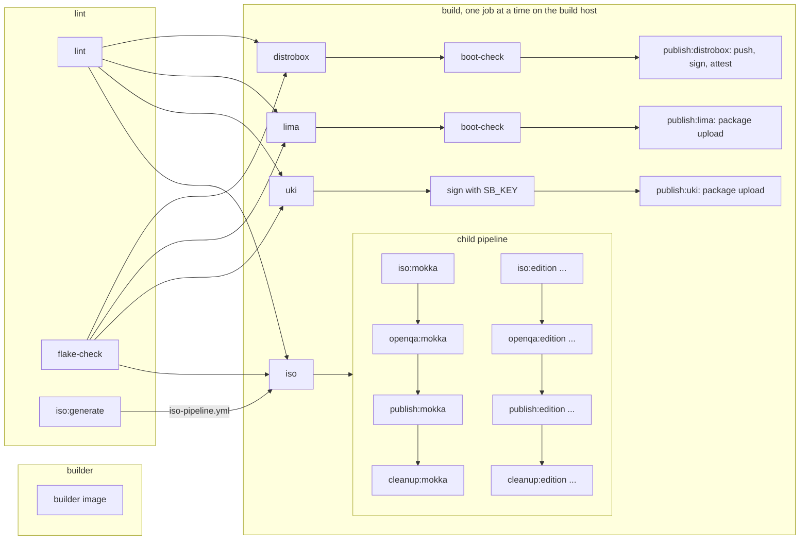

# Continuous integration

`.gitlab-ci.yml` checks, builds and publishes the images on GitLab. The build jobs run `build.sh` in the builder image from `ci/Containerfile`, on a privileged runner on the Garuda build host.

## Configuration

A project maintainer sets the project up once:

1. The build jobs run on the `stormwing-nix-privileged` runner (tag `nix-privileged`) of [infra-nix](https://gitlab.com/garuda-linux/infra-nix): privileged, without user namespace remapping, with `/dev/kvm`, and _Protected_ in GitLab, so it only takes jobs of protected branches and tags, see [Protected refs](#protected-refs). The builds need loop devices and mounts, which only a privileged container has. `flake-check` runs on `stormwing-nix-caching` (tag `nix`), which mounts the Nix store of the host. The `builder` job needs a runner with the tag `dind`. The `lint` and `iso:generate` jobs have no tag and run on any runner that can pull the builder image.
2. Enable the container registry and the package registry of the project. The build jobs use the predefined `CI_REGISTRY_PASSWORD` and `CI_JOB_TOKEN` variables.
3. Build the builder image: run a pipeline on the default branch from the web interface with the `only_builder` input set, or push a change to `ci/Containerfile`. That pipeline runs `builder` and `openqa-image` and nothing else.
4. Add a weekly pipeline schedule on the default branch under _Build > Pipeline schedules_. The weekly build picks up package updates.
5. With openQA in use, add a second weekly schedule on the default branch with the input `only_openqa_image` set. It rebuilds the openQA images on their rolling openSUSE bases and runs nothing else, see [openQA](#openqa).
6. GitLab setting: under _Settings > CI/CD > Variables_, set _Minimum role to use pipeline variables_ to _No one allowed_. A pipeline variable overrides the variables of `.gitlab-ci.yml`, so whoever may set one could replace `BUILDER_IMAGE` with an image of their own, which then runs as root in the build jobs. Everything a run can choose is a pipeline input, see [Inputs](#inputs).
7. GitLab setting: under _Settings > Packages and registries > Container registry > Protected container repositories_, add rules for `builder` and `openqa*` that allow only maintainers to push and delete. The build jobs run `builder:latest` as root with the signing key.

### Protected refs

The build jobs run `build.sh` as root in a privileged container, so whoever can start one has root on the build host. They therefore run only for protected branches and tags (`CI_COMMIT_REF_PROTECTED`): the first rule of `distrobox`, `lima`, `uki`, `builder` and `openqa-image` and of the generated `iso:<edition>` jobs is `when: never` for unprotected refs, and `iso:generate` writes only the `no-iso` job there. `lint` and `iso:generate` still run on every branch.

Protect the default branch under _Settings > Repository > Protected branches_ and allow only maintainers to push and merge. Pushing to an unprotected branch then builds nothing, also with a `[build ...]` tag in the commit message.

### Shared paths

The files each output is built from are listed twice:

- for the distrobox, Lima and UKI jobs, as the `.paths` anchors at the top of `.gitlab-ci.yml` plus the files in each job's own `changes:` rule,
- for the ISO jobs, in `STAMP_PATHS` of `ci/iso_pipeline.py`, see [ISO stamps](#iso-stamps).

Add a new build input to both, otherwise a change to it does not trigger the builds that depend on it. `.gitlab-ci.yml` and `ci/package-changes.sh` are in neither list: after a change to the pipeline that needs a build, put `[build all]` into the commit message.

## Usage

### Jobs

The pipeline runs in four stages:

| Stage   | Job                 | Purpose                                                                                                                                                 |
| ------- | ------------------- | ------------------------------------------------------------------------------------------------------------------------------------------------------- |
| builder | `builder`           | builds the builder image, published as `builder:latest` in the project registry                                                                         |
| builder | `openqa-image`      | builds the isotovideo image `openqa:latest`, the worker image `openqa-worker:latest` and the client image `openqa-client:latest`, see [openQA](#openqa) |
| lint    | `lint`              | runs `scripts/lint.sh`: _shellcheck_, _shfmt_, _ruff_, _yamllint_, _hadolint_, mkosi config of every output and edition                                 |
| lint    | `iso:generate`      | writes the child pipeline with the ISO jobs this pipeline needs                                                                                         |
| lint    | `flake-check`       | runs `nix flake check`: the pre-commit hooks of `flake.nix` (_nixfmt_, _prettier_, _ruff_, _shfmt_, _hadolint_, _commitizen_) in check mode             |
| build   | `distrobox`         | builds and boot-checks the distrobox image                                                                                                              |
| build   | `lima`              | builds and boot-checks the Lima image                                                                                                                   |
| build   | `uki`               | builds the generic UKI, signed with the `SB_KEY`, `SB_CERT` and `SB_CA_CERT` file variables                                                             |
| build   | `iso`               | runs the child pipeline with `iso:<edition>`, `openqa:<edition>`, `publish:<edition>` and `cleanup:<edition>` per edition to build                      |
| publish | `publish:distrobox` | pushes, signs and attests `garuda-distrobox:latest` and `:<version>`                                                                                    |
| publish | `publish:lima`      | signs and uploads the `garuda-lima` package                                                                                                             |
| publish | `publish:uki`       | signs and uploads the `garuda-uki` package                                                                                                              |

The flow of a pipeline on the default branch:



`builder` only runs on a push to the default branch that changes `ci/Containerfile`, and in a pipeline with the `only_builder` input. No schedule rebuilds it: the image installs from the archive snapshot of its dated Arch base, so a rebuild of the same file gives the same packages. Renovate bumps the base tag and the snapshot together. On protected branches other than the default branch, the build jobs end after the boot check, without publishing. Unprotected branches build nothing.

`distrobox`, `lima` and `uki` only build. Each copies its output to `/cache/publish/<output>/<pipeline>/`, because its `after_script` prunes `mkosi.output/`, and its `publish:<output>` job signs and uploads from there and removes the directory. Only the publish jobs have the Sigstore ID token and log in to the registry, so no package scriptlet of a build runs next to them. The `uki` job still has `SB_KEY`, which signs during the build. The predefined job token is in every job. `ci/shared-state.sh prune` removes stages older than a day.

A failing `lint` or `flake-check` job stops the pipeline before any build starts. `flake-check` runs on the `nix` runner, because the builder image has no Nix.

All build jobs, including the ISO jobs of the child pipeline, share the resource group `build-host`, so only one build runs on the build host at a time. A build job may run for 1 hour, an ISO job with `ISO_COMPRESSION=max` for 3 hours. A job is retried once when the runner fails, not after a timeout. The ISO jobs build with `ISO_COMPRESSION=balanced` (zstd level 3, see [Building#Compression](building.md#compression)). For a release, set the `iso_compression` input to `max`, see [Inputs](#inputs). `iso:generate` passes the input to `ci/iso_pipeline.py`, which writes the value and the timeout into the ISO jobs. A pipeline variable `ISO_COMPRESSION` has no effect. The generator lists kde-lite and xfce last, because their base and root layers differ from the other editions. A new commit on a branch cancels the interruptible jobs of the older pipeline of that branch. On the default branch, only `iso:generate` and the `iso:<edition>` jobs of a push pipeline are interruptible. The `distrobox`, `lima` and `uki` jobs, all `publish:` jobs, the lint jobs they wait for, and every job of a schedule or web pipeline are not. Pipelines run for branches only, not a second time for merge requests.

All build jobs share one copy of each layer, across pipelines.

- `ci/shared-state.sh` links `mkosi.output/`, `mkosi.cache/` and `mkosi.workspace/` to `/cache/image-builder/`. The workspace must be on the same device as the output, or mkosi copies every image instead of renaming it.
- Layer stamps and the package check decide what a job reuses, see [Building#Incremental builds](building.md#incremental-builds).
- The tools tree is `/cache/image-builder-tools/`, used while its `key` file matches a hash of `mkosi.conf`, `mkosi.conf.d/` and the mkosi version. `ci/shared-state.sh save-tools` replaces it otherwise.
- `ci/shared-state.sh prune` in `after_script` removes the final images, packages no layer has installed, caches of older releases and old shim downloads. The next job removes the artifact files it leaves.

The `distrobox` and `lima` jobs run [boot-check](testing.md#boot-check) before they stage their output, so an image that does not boot is never published. The registry keeps the last image that did.

Every build job keeps the package manifest of its output for a month, together with a `.manifest.changes` file: the package changes since the last successful build of the same job on the default branch, written by `ci/package-changes.sh`. The changes are the changelog of a build.

### Renovate

[Renovate](https://docs.renovatebot.com/) keeps the pinned versions current. The dedicated Renovate runner of Garuda reads `renovate.json` and opens merge requests for:

- the Arch Linux archive date of the mkosi tools tree (`ToolsTreeSnapshot=` in `mkosi.conf`), from `https://archive.archlinux.org/repos/last/lastsync`. Its commit message contains `[build distrobox]`, so the default branch pipeline after the merge builds and boot-checks the distrobox image with the new tools. The Renovate branches are not protected, so their branch pipelines only lint,
- the container images of `.gitlab-ci.yml`, `ci/iso_pipeline.py`, `ci/Containerfile` and `ci/openqa.Containerfile`. Mutable tags are pinned by digest. The dated Arch base of `ci/Containerfile` keeps its tag and needs `ARCH_SNAPSHOT`, the archive snapshot that pacman installs from, updated with it (`scripts/lint.sh` checks that the dates match),
- `flake.lock`, the inputs of the development shell,
- Fedora's _shim_ (`SHIM_VERSION` in `lib/secureboot.sh`), from the `shim-x64` package of Fedora rawhide on `https://mdapi.fedoraproject.org`,
- _nix-direnv_ in `.envrc`, from the GitHub releases of `nix-community/nix-direnv`.

The _shim_ and _nix-direnv_ pins carry the hash of the download. After the version bump, Renovate runs `ci/renovate-hashes.sh`, which downloads the new file and writes its hash into the same merge request. The runner must allow this command in its `allowedCommands`. The merge request pipeline does not build, so check a _shim_ bump with a signed ISO build before merging. A signed build fails when `shimx64.efi` has no signature of a Microsoft UEFI CA: `lib/secureboot.sh` checks it against `ci/ms-uefi-2011.pem` and `ci/ms-uefi-2023.pem`.

Nothing is merged automatically. The configuration is `renovate.json`.

### ISO child pipeline

The ISO jobs are not listed in `.gitlab-ci.yml`. `ci/iso_pipeline.py` takes the editions from `scripts/editions.sh`, decides which of them need a build, and writes a job for each. Adding an edition directory is therefore enough to get its CI job. When no edition needs a build, the child pipeline holds a single `no-iso` job that does nothing.

### openQA

When the CI/CD variable `OPENQA_DISTRI_URL` holds the clone URL of the test repository, `ci/iso_pipeline.py` adds an `openqa:<edition>` job after each `iso:<edition>` job. It is the gate of the ISO: `publish:<edition>` needs it, so an ISO that fails the tests is never published, neither as `latest` nor as `release`.

The tests run on the openQA instance `https://openqa.garudalinux.org` on aerialis (infra-nix `compose/openqa`), not on the build host. It has a single worker, so one test VM runs at a time, inside a resource ceiling of 8 threads and 20 GB that keeps the web services of aerialis responsive. `ci/openqa-gate.sh` schedules the `install` scenario with `openqa-cli schedule --monitor` and waits for the result:

- The scenario definitions (product, UEFI machine, the `install` job template with the QEMU settings of `scenarios.sh`) travel with the request as `SCENARIO_DEFINITIONS_YAML`. The instance needs no job templates.
- `iso:<edition>` copies the ISO to the staging directory `/publish/iso/<edition>/staging/<pipeline>/` on the ISO mirror, served without a listing. openQA downloads it from there through `ISO_URL`, `iso.builds.garudalinux.org` is its only download domain. `publish:<edition>` publishes from the same directory, and `cleanup:<edition>` deletes it after a successful publish. After a failure the directory stays, so a retried `openqa:<edition>` and `publish:<edition>` still find the ISO. infra-nix removes leftovers after 2 days.
- `CASEDIR` is `OPENQA_DISTRI_URL#OPENQA_DISTRI_REF`. The worker clones that tag for each job, never a branch head, so a new version of the tests is taken in on purpose by changing the variable.
- openQA keeps the results, with screenshots, video and logs, for 90 days. The job log prints the link to the build overview. `BUILD` is the pipeline ID.
- One gate job runs at a time (`resource_group: openqa-aerialis`), so the 2 hour timeout counts the test, not the queue. A cancelled CI job does not cancel the openQA job.
- The gate job runs in `openqa-client:latest` of the project registry, which holds `openqa-cli` and nothing else of openQA.
- CI/CD variables: `OPENQA_HOST` (`https://openqa.garudalinux.org`), `OPENQA_API_KEY` and `OPENQA_API_SECRET` (masked and protected, an API key of an operator, created in the web UI under _Manage API keys_), `OPENQA_DISTRI_URL` and `OPENQA_DISTRI_REF`. Without _Protected_, a branch pipeline that changes `.gitlab-ci.yml` can print the key.

The `openqa-image` job builds three images. Two come from `ci/openqa.Containerfile`, which adds `Inline::Python` (without it isotovideo cannot load the Python tests) and fixed OVMF paths under `/usr/share/garuda-openqa/`:

- `openqa:latest`, from `registry.opensuse.org/devel/openqa/containers/isotovideo:qemu-kvm`, for `run-local.sh` of the test repository,
- `openqa-worker:latest`, from `registry.opensuse.org/devel/openqa/containers16.1/openqa_worker:latest`, the worker of the instance on aerialis,
- `openqa-client:latest`, from `ci/openqa-client.Containerfile`: openSUSE Tumbleweed with the `openQA-client` package, for the `openqa:<edition>` jobs.

With the build argument `BASE` set to `openqa-single-instance`, `ci/openqa.Containerfile` builds the local web UI image of the test repository. The job runs only when `OPENQA_DISTRI_URL` is set: on a push to the default branch that changes one of the two files, and in a pipeline with the `only_openqa_image` or `only_builder` input. The weekly build does not run it, so an outage of `registry.opensuse.org` does not stop the builds. The bases are rolling, its own schedule rebuilds them, see [Configuration](#configuration). Run it once before the first gate run. See [Testing#openQA](testing.md#openqa).

### Triggers

A build runs:

- on a pipeline schedule and on a pipeline started from the web interface, for every output and edition, unless the `editions` input names some, see [Inputs](#inputs),
- on a pipeline started through the trigger API, for the editions in the `editions` input only,
- on a protected git tag named after the release date (`YYYYMMDD`, for example `20261201`), for every edition ISO, see [ISO artifacts](#iso-artifacts). Other tags, such as the versions of `cz bump`, build no ISO,
- when the commit message contains one of the following tags,
- on a push to the default branch that changes files the output depends on. For distrobox, Lima and UKI, against the previous push. For the ISOs, against the stamp of the published ISO, see [ISO stamps](#iso-stamps). A `[build <edition>]` tag replaces the stamp check: only the tagged editions build. An edition without a published ISO counts as changed.

The commit message tags:

| Tag                 | Builds                 |
| ------------------- | ---------------------- |
| `[build all]`       | everything             |
| `[build distrobox]` | the distrobox image    |
| `[build lima]`      | the Lima image         |
| `[build uki]`       | the generic UKI        |
| `[build iso]`       | every edition ISO      |
| `[build <edition>]` | the ISO of `<edition>` |

On protected branches other than the default branch, the jobs build and check but do not publish. On unprotected branches, they do not run, see [Protected refs](#protected-refs).

### Inputs

The pipeline inputs (`spec:inputs` in `.gitlab-ci.yml`) appear in the _Run pipeline_ form. Schedules and the trigger API take them as well.

| Input               | Values                                          | Effect                                                                                                                                                        |
| ------------------- | ----------------------------------------------- | ------------------------------------------------------------------------------------------------------------------------------------------------------------- |
| `editions`          | `all` or edition names, default empty           | builds only these ISOs, without distrobox, Lima and UKI. Empty builds what the pipeline builds anyway. A trigger API pipeline with no editions builds nothing |
| `iso_compression`   | `balanced` (default), `max`                     | the compression of the ISOs                                                                                                                                   |
| `only_builder`      | `false` (default), `true`                       | runs `builder` and `openqa-image` and nothing else                                                                                                            |
| `only_openqa_image` | `false` (default), `true`                       | runs `openqa-image` and nothing else, for its schedule                                                                                                        |
| `mirror_kind`       | `release` (default), `latest`                   | the directory `mirror:<edition>` copies, see [Mirrors](#mirrors)                                                                                              |
| `mirror_root`       | `image-builder` (default), `image-builder-test` | the target directory of `mirror:<edition>`                                                                                                                    |
| `mirror_dry_run`    | `false` (default), `true`                       | `mirror:<edition>` only lists what it would copy                                                                                                              |

Pipeline variables are not used and should be turned off, see [Configuration](#configuration).

The edition list of `editions` must match `scripts/editions.sh`, `scripts/lint.sh` checks it. Add a new edition there too.

To build the ISOs that contain a package after it reached the repositories, for example from the CI of the package, create a pipeline trigger token under _Settings > CI/CD > Pipeline trigger tokens_ and call:

```console
$ curl --request POST --form token=<token> --form ref=main \
    --form 'inputs[editions]=["mokka","gnome"]' \
    https://gitlab.com/api/v4/projects/garuda-linux%2Ftools%2Fimage-builder/trigger/pipeline
```

Array inputs are passed as JSON.

### ISO stamps

The stamp of an edition is a SHA-256 over the edition name and `git ls-files --stage` (mode, blob hash and path) of `STAMP_PATHS` in `ci/iso_pipeline.py`, without the profile directories of other editions. Package updates are not part of it, the weekly schedule picks them up.

- `iso:<edition>` writes it to `garuda-<edition>.stamp` next to the ISO, and `ci/publish-iso.sh` publishes it under that fixed name.
- `iso:generate` fetches `https://iso.builds.garudalinux.org/iso/image-builder/<edition>/latest/garuda-<edition>.stamp` on a push to the default branch and builds every edition whose stamp differs, so a cancelled push pipeline loses no changes. A missing stamp or an unreachable mirror builds the edition.
- `ci/iso_pipeline.py --stamp <edition>` prints the stamp of the checkout.

`iso:<edition>` copies the ISO to the staging directory `/publish/iso/<edition>/staging/<pipeline>/`, because its `after_script` prunes `mkosi.output/`. `openqa:<edition>` tests it from there, `publish:<edition>` uploads from there, and `cleanup:<edition>` removes the directory, see [openQA](#openqa).

## Publishing

The `publish:lima` job uploads the disk image to the generic package `garuda-lima` twice: as `<version>/garuda-lima-<version>.qcow2`, and as `latest/garuda-lima.qcow2` under a fixed name, so the download URL of the newest image does not change:

```text
https://gitlab.com/api/v4/projects/garuda-linux%2Ftools%2Fimage-builder/packages/generic/garuda-lima/latest/garuda-lima.qcow2
```

The `publish:uki` job uploads `garuda-<kernel>-<version>.efi`, `garuda-<kernel>-<version>-eac.efi` and their `.sha256` files to the generic package `garuda-uki` under `<version>/`, and the UKIs as `latest/garuda-<kernel>.efi` and `latest/garuda-<kernel>-eac.efi`. A signed build also uploads both UKIs and the enrollment cert under the kernel version, for example `7.3.1-1/garuda-linux-garuda.efi`, `7.3.1-1/garuda-linux-garuda-eac.efi` and `7.3.1-1/garuda-secureboot.crt`. That version is the source of the `garuda-uki` pacman package and is never overwritten: a later build of the same kernel leaves it as it is, so the sha256 sums pinned in the package stay valid, see the `garuda-uki` package in [pkgbuilds](https://gitlab.com/garuda-linux/pkgbuilds). The job asks the registry for the file first: an answer of 404 uploads, a found file skips, and any other answer fails the job without an upload under the kernel version.

Signing in CI: add `SB_KEY`, `SB_CERT` and `SB_CA_CERT` as protected variables of type _File_ in the project settings, with the environment scope `signing`. Only the `uki` and `iso:<edition>` jobs name that environment (`action: access`, so no deployment is recorded), and no other job of a protected ref gets the key. GitLab then sets each variable to the path of a file with its content, which is what `build.sh` expects, see [Building#Signing](building.md#signing). Without them, the jobs build unsigned. The ISO jobs pick them up the same way. Only the signing key is in CI, the CA key stays offline.

Every uploaded image and UKI has a `.sha256` file and its Sigstore bundle `.sha256.sigstore.json` next to it, also under `latest/` and the kernel version. `ci/cosign-blob.sh` signs the checksum with cosign in keyless mode, as for the ISOs, see [ISO artifacts](#iso-artifacts) for the verification. A failed signature fails the job before the upload.

GitLab keeps every upload of the same file name as a duplicate and serves the newest one. Delete old duplicates under _Deploy > Package registry_ if storage matters.

The dated tag `garuda-distrobox:<version>` names one build for good. The first build of a day writes it. Later builds on the same day only move `latest`. Pushes are retried five times. The signature and the attestations name the digest that _skopeo_ wrote for the push of `latest` (`--digestfile`), not the digest the tag has afterwards.

### Signature

The distrobox image is signed with [cosign](https://github.com/sigstore/cosign) in keyless mode. The OIDC token of the job (`id_tokens`, audience `sigstore`) identifies the pipeline to Sigstore, and the signature is recorded in the Rekor transparency log. No signing key exists that could leak. To verify an image against the pipeline identity of the default branch:

```console
$ cosign verify \
    --certificate-identity "https://gitlab.com/garuda-linux/tools/image-builder//.gitlab-ci.yml@refs/heads/<default_branch>" \
    --certificate-oidc-issuer https://gitlab.com \
    registry.gitlab.com/garuda-linux/tools/image-builder/garuda-distrobox:latest
```

where `<default_branch>` is the default branch of the project.

### Attestations

`publish:distrobox` attaches two signed in-toto attestations to the image digest, also keyless:

- the SPDX SBOM of the image (`--type spdxjson`), see [Building#SBOM](building.md#sbom),
- an SLSA v1 build provenance (`--type slsaprovenance1`) from `ci/provenance.py`, written by the `distrobox` job: the repository, commit, pipeline, job, builder image and runner that made the image. The builder image carries the digest that its tag had when the job wrote the provenance. The runner may have used an older cached copy of the tag.

To verify and read them, use the same identity as for the signature:

```console
$ cosign verify-attestation --type slsaprovenance1 \
    --certificate-identity "https://gitlab.com/garuda-linux/tools/image-builder//.gitlab-ci.yml@refs/heads/<default_branch>" \
    --certificate-oidc-issuer https://gitlab.com \
    registry.gitlab.com/garuda-linux/tools/image-builder/garuda-distrobox:latest
```

Use `--type spdxjson` for the SBOM. For the job artifacts, GitLab writes its own SLSA provenance (`artifacts-metadata.json`), turned on with `RUNNER_GENERATE_ARTIFACTS_METADATA`.

### ISO artifacts

The ISO jobs keep `garuda-<edition>.iso.manifest`, its `.changes` file, the SPDX SBOM, the `.sha256` checksum and its signature as artifacts, where `<edition>` is the edition name. The ISO itself, about 5 GB, exceeds the artifact size limit.

`ci/publish-iso.sh` copies the ISO, its checksum, the signature of the checksum, manifest and SBOM to `https://iso.builds.garudalinux.org/iso/image-builder/<edition>/<kind>/`, with the versioned ISO name for all five files:

| `<kind>`  | Pipeline           | Kept                   |
| --------- | ------------------ | ---------------------- |
| `latest`  | the default branch | until the next push    |
| `release` | a date tag         | until the next release |

Before the upload, the script signs the `.sha256` file with cosign in keyless mode, as the distrobox image (see [Signature](#signature)), and writes the Sigstore bundle `<iso>.sha256.sigstore.json`. It tries five times, 30 seconds apart, then fails without publishing, so no unsigned ISO goes out. It verifies the bundle before the upload. The job runs in the ISO child pipeline, but the certificate names the top-level `.gitlab-ci.yml`, which the `ci_config_ref_uri` claim of the job token refers to. To verify a release ISO, with `<date>` its tag:

```console
$ cosign verify-blob --bundle garuda-mokka-linux-garuda-<date>.iso.sha256.sigstore.json \
    --certificate-identity "https://gitlab.com/garuda-linux/tools/image-builder//.gitlab-ci.yml@refs/tags/<date>" \
    --certificate-oidc-issuer https://gitlab.com \
    garuda-mokka-linux-garuda-<date>.iso.sha256
$ sha256sum -c garuda-mokka-linux-garuda-<date>.iso.sha256
```

A latest ISO has `@refs/heads/<default_branch>` instead.

Each upload replaces the whole directory of its kind, so an edition has at most one release and one latest ISO. A release ISO carries its tag as version, for example `garuda-mokka-linux-garuda-20261201.iso`, also when the build runs on a later day. Other branches publish nothing. The runner `stormwing-nix-privileged` mounts `/data_1/iso/iso/image-builder` of stormwing as `/publish/iso` in the job container, see `dockerExtraVolumes` in infra-nix. `cleanup:<edition>` removes the staging copy after the upload.

### Mirrors

`mirror:<edition>` copies `/publish/iso/<edition>/release/` with `ci/mirror-iso.sh` to the paths the `?r2=1` and `?sourceforge=1` redirects of `iso.builds.garudalinux.org` point to:

| Target      | Path                                                                                              | Tool             |
| ----------- | ------------------------------------------------------------------------------------------------- | ---------------- |
| R2          | `r2:/mirror/iso/image-builder/<edition>/release/`                                                 | `rclone sync`    |
| SourceForge | `garuda-team@frs.sourceforge.net:/home/frs/project/garuda-linux/image-builder/<edition>/release/` | `rsync --delete` |

The job runs on date tags after `publish:<edition>`, and as a manual job on the default branch. Both targets replace the directory like the local upload. A failed upload does not fail the pipeline (`allow_failure`).

CI/CD variables, both of type _File_, masked and protected. A target without its variable is skipped. Without both, the job is not created:

| Variable              | Content                                                                          |
| --------------------- | -------------------------------------------------------------------------------- |
| `R2_RCLONE_CONFIG`    | the rclone config with the `r2` remote, sops `cloudflare/r2_rclone` of infra-nix |
| `SOURCEFORGE_SSH_KEY` | the private key of `garuda-team`, sops `keypairs/ssh_team/private` of infra-nix  |

The SourceForge upload only accepts the host keys in `ci/sourceforge-known-hosts`, the keys of `frs.sourceforge.net` as [SourceForge publishes their fingerprints](https://sourceforge.net/p/forge/documentation/SSH%20Key%20Fingerprints/). When SourceForge changes a key, the upload fails until the file has the new one.

To test without touching a release, run a pipeline on the default branch from the web interface with these inputs and the `editions` to test, then start the manual job:

| Input            | Test value             | Default         |
| ---------------- | ---------------------- | --------------- |
| `mirror_kind`    | `latest`               | `release`       |
| `mirror_root`    | `image-builder-test`   | `image-builder` |
| `mirror_dry_run` | `true` for a first run | `false`         |

### Torrent

`ci/publish-iso.sh` writes `<iso>.torrent` next to a release ISO with _mktorrent_, before the upload, so all three targets carry it. It has 4 MiB pieces, the trackers `tracker.opentrackr.org`, `open.stealth.si`, `tracker.torrent.eu.org` and `open.demonii.com`, and R2, SourceForge and `iso.builds.garudalinux.org` as web seeds. Nobody seeds it: clients download from the web seeds and from each other. A latest ISO gets no torrent.

## Known issues

- A _zsync_ file is not created yet.
- Whether the artifacts API finds the previous manifest of a job in a child pipeline is not confirmed. If not, every ISO build reports a first build in its `.changes` file.

## See also

- [Testing](testing.md)
- [GitLab CI/CD YAML reference](https://docs.gitlab.com/ci/yaml/)
- [GitLab downstream pipelines](https://docs.gitlab.com/ci/pipelines/downstream_pipelines/)
- [cosign keyless signing](https://docs.sigstore.dev/cosign/signing/overview/)
