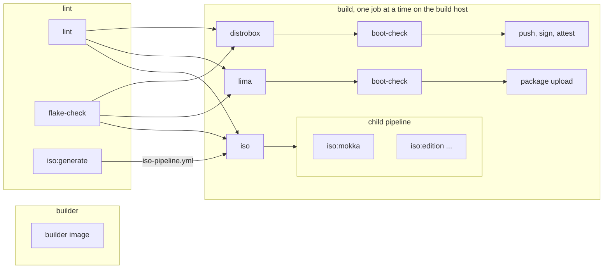

# Continuous integration

`.gitlab-ci.yml` checks, builds and publishes the images on GitLab. The build jobs run `build.sh` in the builder image from `ci/Containerfile`, on a privileged runner on the Garuda build host.

## Configuration

A project maintainer sets the project up once:

1. The build jobs run on the `stormwing-nix-privileged` runner (tag `nix-privileged`) of [infra-nix](https://gitlab.com/garuda-linux/infra-nix): privileged, without user namespace remapping, with `/dev/kvm`, and _Protected_ in GitLab, so it only takes jobs of protected branches and tags, see [Protected refs](#protected-refs). The builds need loop devices and mounts, which only a privileged container has. `flake-check` runs on `stormwing-nix-caching` (tag `nix`), which mounts the Nix store of the host. The `builder` job needs a runner with the tag `dind`. The `lint` and `iso:generate` jobs have no tag and run on any runner that can pull the builder image.
2. Build the builder image: run a pipeline from the web interface and start the manual `builder` job, or push a change to `ci/Containerfile`.
3. Add a weekly pipeline schedule on the default branch under _Build > Pipeline schedules_. The weekly build picks up package updates.
4. Enable the container registry and the package registry of the project. The build jobs use the predefined `CI_REGISTRY_PASSWORD` and `CI_JOB_TOKEN` variables.
5. For Renovate, create a project access token with the `api` and `write_repository` scopes and the _Developer_ role, and store it as the masked CI/CD variable `RENOVATE_TOKEN`. Then add a second weekly pipeline schedule with the variable `RENOVATE` set to `true`, see [Renovate](#renovate).

### Protected refs

The build jobs run `build.sh` as root in a privileged container, so whoever can start one has root on the build host. They therefore run only for protected branches and tags (`CI_COMMIT_REF_PROTECTED`): the first rule of `distrobox` and `lima` and of the generated `iso:<edition>` jobs is `when: never` for unprotected refs, and `iso:generate` writes only the `no-iso` job there. `lint` and `iso:generate` still run on every branch.

Protect the default branch under _Settings > Repository > Protected branches_ and allow only maintainers to push and merge. Pushing to an unprotected branch then builds nothing, also with a `[build ...]` tag in the commit message.

### Shared paths

A change to a shared file rebuilds every output that depends on it. The shared files are listed twice:

- for the distrobox and Lima jobs, as YAML anchors under `.paths` at the top of `.gitlab-ci.yml`,
- for the ISO jobs, in the `shared` list of `ci/iso_pipeline.py`.

Add a new shared file to both, otherwise a change to it does not trigger the builds that depend on it.

## Usage

### Jobs

The pipeline runs in three stages:

| Stage   | Job            | Purpose                                                                                                                         |
| ------- | -------------- | ------------------------------------------------------------------------------------------------------------------------------- |
| builder | `builder`      | builds the builder image, published as `builder:latest` in the project registry                                                 |
| lint    | `lint`         | runs `scripts/lint.sh`: _shellcheck_, _shfmt_, _ruff_, _yamllint_, mkosi config of every output and edition                     |
| lint    | `iso:generate` | writes the child pipeline with the ISO jobs this pipeline needs                                                                 |
| lint    | `flake-check`  | runs `nix flake check`: the pre-commit hooks of `flake.nix` (_nixfmt_, _prettier_, _ruff_, _shfmt_, _commitizen_) in check mode |
| build   | `distrobox`    | builds, boot-checks, signs and publishes `garuda-distrobox:latest` and `:<version>`                                             |
| build   | `lima`         | builds, boot-checks and publishes the `garuda-lima` package                                                                     |
| build   | `iso`          | runs the child pipeline with one `iso:<edition>` job per edition to build                                                       |

The flow of a pipeline on the default branch:



`builder` only runs on a pipeline schedule, when `ci/Containerfile` changed, or when started by hand. The schedule rebuild picks up the package updates of the dated Arch base image. On protected branches other than the default branch, the build jobs end after the boot check, without publishing. Unprotected branches build nothing.

A failing `lint` or `flake-check` job stops the pipeline before any build starts. `flake-check` runs on the `nix` runner, because the builder image has no Nix.

All build jobs, including the ISO jobs of the child pipeline, share the resource group `build-host`, so only one build runs on the build host at a time. A job may run for 3 hours, enough for an ISO with `ISO_COMPRESSION=max`, and is retried once when the runner fails. A new commit on a branch cancels the running jobs of the older pipeline of that branch. On the default branch, where a job may be publishing, it does not. Pipelines run for branches only, not a second time for merge requests.

The `distrobox` and `lima` jobs run [boot-check](testing.md#boot-check) before they publish, so an image that does not boot is never published. The registry keeps the last image that did.

Every build job keeps the package manifest of its output for a month, together with a `.manifest.changes` file: the package changes since the last successful build of the same job on the default branch, written by `ci/package-changes.sh`. The changes are the changelog of a build.

### Renovate

[Renovate](https://docs.renovatebot.com/) keeps the pinned versions current. The `renovate` job runs on its own pipeline schedule (variable `RENOVATE=true`), which runs no other job. Each Monday, it opens merge requests for:

- the Arch Linux archive date of the mkosi tools tree (`ToolsTreeSnapshot=` in `mkosi.conf`), from `https://archive.archlinux.org/repos/last/lastsync`. Its commit message contains `[build distrobox]`, so the default branch pipeline after the merge builds and boot-checks the distrobox image with the new tools. The Renovate branches are not protected, so their branch pipelines only lint,
- the container images of `.gitlab-ci.yml` and `ci/iso_pipeline.py`, and the dated Arch base image (`base-YYYYMMDD.0.N`) of `ci/Containerfile`,
- `flake.lock`, the inputs of the development shell.

Nothing is merged automatically. The configuration is `renovate.json`.

### ISO child pipeline

The ISO jobs are not listed in `.gitlab-ci.yml`. `ci/iso_pipeline.py` takes the editions from `scripts/editions.sh`, decides which of them need a build, and writes a job for each. Adding an edition directory is therefore enough to get its CI job. When no edition needs a build, the child pipeline holds a single `no-iso` job that does nothing.

### openQA

When the CI/CD variable `OPENQA_DISTRI_URL` holds the clone URL of the test repository, `ci/iso_pipeline.py` adds an `openqa:<edition>` job after each `iso:<edition>` job. It runs the tests with `isotovideo` in the `registry.opensuse.org/devel/openqa/containers/isotovideo:qemu-kvm` image on the `nix-privileged` runner, which has KVM. See [Testing#openQA](testing.md#openqa).

- The next job starts with a clean workspace, so the ISO job copies its ISO to `/cache/openqa/<pipeline>/` on the runner's cache volume. The test job deletes it at the end.
- The jobs report only (`allow_failure`): a failed test does not stop publishing until the tests are stable.
- The results stay for two weeks as artifacts: `testresults/` with the screenshots and the result of each test, `video.ogv`, `autoinst-log.txt` and `serial0`.

### Triggers

A build runs:

- on a pipeline schedule and on a pipeline started from the web interface, for every output and edition,
- when the commit message contains one of the following tags,
- on a push to the default branch that changes files the output depends on. A change to an edition profile builds only that edition. A change to shared files, such as `mkosi.conf`, `build.sh` or the `base` layer, builds every output.

The commit message tags:

| Tag                 | Builds                 |
| ------------------- | ---------------------- |
| `[build all]`       | everything             |
| `[build distrobox]` | the distrobox image    |
| `[build lima]`      | the Lima image         |
| `[build iso]`       | every edition ISO      |
| `[build <edition>]` | the ISO of `<edition>` |

On protected branches other than the default branch, the jobs build and check but do not publish. On unprotected branches, they do not run, see [Protected refs](#protected-refs).

## Publishing

The `lima` job uploads the disk image to the generic package `garuda-lima` twice: as `<version>/garuda-lima-<version>.qcow2`, and as `latest/garuda-lima.qcow2` under a fixed name, so the download URL of the newest image does not change:

```text
https://gitlab.com/api/v4/projects/garuda-linux%2Ftools%2Fimage-builder/packages/generic/garuda-lima/latest/garuda-lima.qcow2
```

GitLab keeps every upload of the same file name as a duplicate and serves the newest one. Delete old duplicates under _Deploy > Package registry_ if storage matters.

The dated tag `garuda-distrobox:<version>` names one build for good. The first build of a day writes it. Later builds on the same day only move `latest`. Pushes are retried five times.

### Signature

The distrobox image is signed with [cosign](https://github.com/sigstore/cosign) in keyless mode. The OIDC token of the job (`id_tokens`, audience `sigstore`) identifies the pipeline to Sigstore, and the signature is recorded in the Rekor transparency log. No signing key exists that could leak. To verify an image against the pipeline identity of the default branch:

```console
$ cosign verify \
    --certificate-identity "https://gitlab.com/garuda-linux/tools/image-builder//.gitlab-ci.yml@refs/heads/<default_branch>" \
    --certificate-oidc-issuer https://gitlab.com \
    registry.gitlab.com/garuda-linux/tools/image-builder/garuda-distrobox:latest
```

where `<default_branch>` is the default branch of the project.

### Attestations

The same job attaches two signed in-toto attestations to the image digest, also keyless:

- the SPDX SBOM of the image (`--type spdxjson`), see [Building#SBOM](building.md#sbom),
- an SLSA v1 build provenance (`--type slsaprovenance1`) from `ci/provenance.py`: the repository, commit, pipeline, job, builder image and runner that made the image.

To verify and read them, use the same identity as for the signature:

```console
$ cosign verify-attestation --type slsaprovenance1 \
    --certificate-identity "https://gitlab.com/garuda-linux/tools/image-builder//.gitlab-ci.yml@refs/heads/<default_branch>" \
    --certificate-oidc-issuer https://gitlab.com \
    registry.gitlab.com/garuda-linux/tools/image-builder/garuda-distrobox:latest
```

Use `--type spdxjson` for the SBOM. For the job artifacts, GitLab writes its own SLSA provenance (`artifacts-metadata.json`), turned on with `RUNNER_GENERATE_ARTIFACTS_METADATA`.

### ISO artifacts

The ISO jobs keep `garuda-<edition>.iso.manifest`, its `.changes` file, the SPDX SBOM and the `.sha256` checksum as artifacts, where `<edition>` is the edition name. The ISO itself, about 5 GB, exceeds the artifact size limit and stays in `mkosi.output/` on the runner host until the next build.

## Known issues

- As of November 2026, the ISOs are not published. Planned targets are the Garuda download server and SourceForge through _rsync_, and an R2 bucket. A torrent and a _zsync_ file follow once the download URLs are fixed, because both embed them.
- Whether the artifacts API finds the previous manifest of a job in a child pipeline is not confirmed. If not, every ISO build reports a first build in its `.changes` file.

## See also

- [Testing](testing.md)
- [GitLab CI/CD YAML reference](https://docs.gitlab.com/ci/yaml/)
- [GitLab downstream pipelines](https://docs.gitlab.com/ci/pipelines/downstream_pipelines/)
- [cosign keyless signing](https://docs.sigstore.dev/cosign/signing/overview/)
