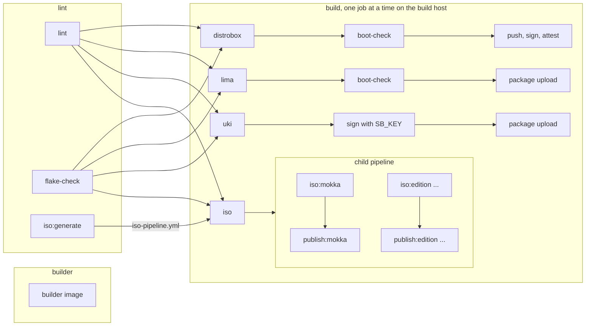

# Continuous integration

`.gitlab-ci.yml` checks, builds and publishes the images on GitLab. The build jobs run `build.sh` in the builder image from `ci/Containerfile`, on a privileged runner on the Garuda build host.

## Configuration

A project maintainer sets the project up once:

1. The build jobs run on the `stormwing-nix-privileged` runner (tag `nix-privileged`) of [infra-nix](https://gitlab.com/garuda-linux/infra-nix): privileged, without user namespace remapping, with `/dev/kvm`, and _Protected_ in GitLab, so it only takes jobs of protected branches and tags, see [Protected refs](#protected-refs). The builds need loop devices and mounts, which only a privileged container has. `flake-check` runs on `stormwing-nix-caching` (tag `nix`), which mounts the Nix store of the host. The `builder` job needs a runner with the tag `dind`. The `lint` and `iso:generate` jobs have no tag and run on any runner that can pull the builder image.
2. Build the builder image: run a pipeline from the web interface and start the manual `builder` job, or push a change to `ci/Containerfile`.
3. Add a weekly pipeline schedule on the default branch under _Build > Pipeline schedules_. The weekly build picks up package updates.
4. Enable the container registry and the package registry of the project. The build jobs use the predefined `CI_REGISTRY_PASSWORD` and `CI_JOB_TOKEN` variables.
5. For Renovate, create a project access token with the `api` and `write_repository` scopes and the _Developer_ role, and store it as the masked CI/CD variable `RENOVATE_TOKEN`. Then add a second weekly pipeline schedule with the variable `RENOVATE` set to `true`, see [Renovate](#renovate).

### Protected refs

The build jobs run `build.sh` as root in a privileged container, so whoever can start one has root on the build host. They therefore run only for protected branches and tags (`CI_COMMIT_REF_PROTECTED`): the first rule of `distrobox` and `lima` and of the generated `iso:<edition>` jobs is `when: never` for unprotected refs, and `iso:generate` writes only the `no-iso` job there. `lint` and `iso:generate` still run on every branch.

Protect the default branch under _Settings > Repository > Protected branches_ and allow only maintainers to push and merge. Pushing to an unprotected branch then builds nothing, also with a `[build ...]` tag in the commit message.

### Shared paths

The files each output is built from are listed twice:

- for the distrobox, Lima and UKI jobs, as the `.paths` anchors at the top of `.gitlab-ci.yml` plus the files in each job's own `changes:` rule,
- for the ISO jobs, in `STAMP_PATHS` of `ci/iso_pipeline.py`, see [ISO stamps](#iso-stamps).

Add a new build input to both, otherwise a change to it does not trigger the builds that depend on it.

## Usage

### Jobs

The pipeline runs in three stages:

| Stage   | Job            | Purpose                                                                                                                                     |
| ------- | -------------- | ------------------------------------------------------------------------------------------------------------------------------------------- |
| builder | `builder`      | builds the builder image, published as `builder:latest` in the project registry                                                             |
| builder | `openqa-image` | builds the isotovideo image for the openQA jobs, published as `openqa:latest`, see [openQA](#openqa)                                        |
| lint    | `lint`         | runs `scripts/lint.sh`: _shellcheck_, _shfmt_, _ruff_, _yamllint_, _hadolint_, mkosi config of every output and edition                     |
| lint    | `iso:generate` | writes the child pipeline with the ISO jobs this pipeline needs                                                                             |
| lint    | `flake-check`  | runs `nix flake check`: the pre-commit hooks of `flake.nix` (_nixfmt_, _prettier_, _ruff_, _shfmt_, _hadolint_, _commitizen_) in check mode |
| build   | `distrobox`    | builds, boot-checks, signs and publishes `garuda-distrobox:latest` and `:<version>`                                                         |
| build   | `lima`         | builds, boot-checks and publishes the `garuda-lima` package                                                                                 |
| build   | `uki`          | builds the generic UKI, signed with the `SB_KEY`, `SB_CERT` and `SB_CA_CERT` file variables, and publishes the `garuda-uki` package         |
| build   | `iso`          | runs the child pipeline with one `iso:<edition>` and one `publish:<edition>` job per edition to build                                       |

The flow of a pipeline on the default branch:



`builder` only runs on a pipeline schedule, when `ci/Containerfile` changed, or when started by hand. The schedule rebuild picks up the package updates of the dated Arch base image. On protected branches other than the default branch, the build jobs end after the boot check, without publishing. Unprotected branches build nothing.

A failing `lint` or `flake-check` job stops the pipeline before any build starts. `flake-check` runs on the `nix` runner, because the builder image has no Nix.

All build jobs, including the ISO jobs of the child pipeline, share the resource group `build-host`, so only one build runs on the build host at a time. A job may run for 3 hours, enough for an ISO with `ISO_COMPRESSION=max`, and is retried once when the runner fails. The ISO jobs build with `ISO_COMPRESSION=balanced` (zstd level 3, see [Building#Compression](building.md#compression)). For a release, set the `iso_compression` input to `max`, see [Inputs](#inputs). A pipeline variable `ISO_COMPRESSION` still overrides it. `ci/iso_pipeline.py` writes the value into the ISO jobs. A new commit on a branch cancels the interruptible jobs of the older pipeline of that branch. On the default branch, only `iso:generate` and the `iso:<edition>` jobs of a push pipeline are interruptible. Jobs that publish (`distrobox`, `lima`, `uki`, `publish:<edition>`), the lint jobs they wait for, and every job of a schedule or web pipeline are not. Pipelines run for branches only, not a second time for merge requests.

All build jobs share one copy of each layer, across pipelines.

- `ci/shared-state.sh` links `mkosi.output/`, `mkosi.cache/` and `mkosi.workspace/` to `/cache/image-builder/`. The workspace must be on the same device as the output, or mkosi copies every image instead of renaming it.
- Layer stamps and the package check decide what a job reuses, see [Building#Incremental builds](building.md#incremental-builds).
- The tools tree is `/cache/image-builder-tools/`, used while its `key` file matches a hash of `mkosi.conf`, `mkosi.conf.d/` and the mkosi version. `ci/shared-state.sh save-tools` replaces it otherwise.
- `ci/shared-state.sh prune` in `after_script` removes the final images, packages no layer has installed, caches of older releases and old shim downloads. The next job removes the artifact files it leaves.
- The openQA ISO is `/cache/openqa/garuda-<edition>.iso`. An openQA job fails when `garuda-<edition>.iso.pipeline` names another pipeline.

The `distrobox` and `lima` jobs run [boot-check](testing.md#boot-check) before they publish, so an image that does not boot is never published. The registry keeps the last image that did.

Every build job keeps the package manifest of its output for a month, together with a `.manifest.changes` file: the package changes since the last successful build of the same job on the default branch, written by `ci/package-changes.sh`. The changes are the changelog of a build.

### Renovate

[Renovate](https://docs.renovatebot.com/) keeps the pinned versions current. The `renovate` job runs on its own pipeline schedule (variable `RENOVATE=true`), which runs no other job. Each Monday, it opens merge requests for:

- the Arch Linux archive date of the mkosi tools tree (`ToolsTreeSnapshot=` in `mkosi.conf`), from `https://archive.archlinux.org/repos/last/lastsync`. Its commit message contains `[build distrobox]`, so the default branch pipeline after the merge builds and boot-checks the distrobox image with the new tools. The Renovate branches are not protected, so their branch pipelines only lint,
- the container images of `.gitlab-ci.yml`, `ci/iso_pipeline.py`, `ci/Containerfile` and `ci/openqa.Containerfile`. Mutable tags are pinned by digest. The dated Arch base of `ci/Containerfile` keeps its tag and needs `ARCH_SNAPSHOT`, the archive snapshot that pacman installs from, updated with it (`scripts/lint.sh` checks that the dates match),
- `flake.lock`, the inputs of the development shell,
- Fedora's _shim_ (`SHIM_VERSION` in `lib/secureboot.sh`), from the `shim-x64` package of Fedora rawhide on `https://mdapi.fedoraproject.org`,
- _nix-direnv_ in `.envrc`, from the GitHub releases of `nix-community/nix-direnv`.

The _shim_ and _nix-direnv_ pins carry the hash of the download. After the version bump, Renovate runs `ci/renovate-hashes.sh`, which downloads the new file and writes its hash into the same merge request. The job allows only this command (`RENOVATE_ALLOWED_COMMANDS` in `.gitlab-ci.yml`). The merge request pipeline does not build, so check a _shim_ bump with a signed ISO build before merging.

Nothing is merged automatically. The configuration is `renovate.json`.

### ISO child pipeline

The ISO jobs are not listed in `.gitlab-ci.yml`. `ci/iso_pipeline.py` takes the editions from `scripts/editions.sh`, decides which of them need a build, and writes a job for each. Adding an edition directory is therefore enough to get its CI job. When no edition needs a build, the child pipeline holds a single `no-iso` job that does nothing.

### openQA

When the CI/CD variable `OPENQA_DISTRI_URL` holds the clone URL of the test repository, `ci/iso_pipeline.py` adds an `openqa:<edition>` job after each `iso:<edition>` job. The job checks out the tag or commit in `OPENQA_DISTRI_REF`, never a branch head: the tests run as root on the build host, so a new version of them is taken in on purpose by changing the variable. It runs the tests with `isotovideo` on the `nix-privileged` runner, which has KVM, in the `openqa:latest` image of the project registry. One test VM runs at a time (`resource_group: openqa-host`), next to at most one ISO build. The `openqa-image` job builds it from `ci/openqa.Containerfile`: the upstream image `registry.opensuse.org/devel/openqa/containers/isotovideo:qemu-kvm` plus `Inline::Python`, without which isotovideo cannot load the Python tests. With the build argument `BASE` set to `openqa-single-instance`, the same file builds the local web UI image of the test repository. It runs like `builder`, and only when `OPENQA_DISTRI_URL` is set. Start it once by hand before the first openQA run. See [Testing#openQA](testing.md#openqa).

- The next job starts with a clean workspace, so the ISO job copies its ISO to `/cache/openqa/<pipeline>/` on the runner's cache volume. The test job deletes it at the end, and the ISO job removes directories two days or older, left by test jobs that never ran or were cancelled.
- The jobs report only (`allow_failure`): a failed test does not stop publishing until the tests are stable.
- The results stay for two weeks as artifacts: `testresults/` with the screenshots and the result of each test, `video.ogv`, `autoinst-log.txt` and `serial0`.

### Triggers

A build runs:

- on a pipeline schedule and on a pipeline started from the web interface, for every output and edition, unless the `editions` input names some, see [Inputs](#inputs),
- on a pipeline started through the trigger API, for the editions in the `editions` input only,
- on a protected git tag named after the release date (`YYYYMMDD`, for example `20261201`), for every edition ISO, see [ISO artifacts](#iso-artifacts). Other tags, such as the versions of `cz bump`, build no ISO,
- when the commit message contains one of the following tags,
- on a push to the default branch that changes files the output depends on. For distrobox, Lima and UKI, against the previous push. For the ISOs, against the stamp of the published ISO, see [ISO stamps](#iso-stamps).

The commit message tags:

| Tag                 | Builds                 |
| ------------------- | ---------------------- |
| `[build all]`       | everything             |
| `[build distrobox]` | the distrobox image    |
| `[build lima]`      | the Lima image         |
| `[build uki]`       | the generic UKI        |
| `[build iso]`       | every edition ISO      |
| `[build <edition>]` | the ISO of `<edition>` |

On protected branches other than the default branch, the jobs build and check but do not publish. On unprotected branches, they do not run, see [Protected refs](#protected-refs).

### Inputs

The pipeline inputs (`spec:inputs` in `.gitlab-ci.yml`) appear in the _Run pipeline_ form. Schedules and the trigger API take them as well.

| Input             | Values                                | Effect                                                                                                                                                        |
| ----------------- | ------------------------------------- | ------------------------------------------------------------------------------------------------------------------------------------------------------------- |
| `editions`        | `all` or edition names, default empty | builds only these ISOs, without distrobox, Lima and UKI. Empty builds what the pipeline builds anyway. A trigger API pipeline with no editions builds nothing |
| `iso_compression` | `balanced` (default), `max`           | the compression of the ISOs                                                                                                                                   |

The edition list of `editions` must match `scripts/editions.sh`, `scripts/lint.sh` checks it. Add a new edition there too.

To build the ISOs that contain a package after it reached the repositories, for example from the CI of the package, create a pipeline trigger token under _Settings > CI/CD > Pipeline trigger tokens_ and call:

```console
$ curl --request POST --form token=<token> --form ref=main \
    --form 'inputs[editions]=["mokka","gnome"]' \
    https://gitlab.com/api/v4/projects/garuda-linux%2Ftools%2Fimage-builder/trigger/pipeline
```

Array inputs are passed as JSON.

### ISO stamps

The stamp of an edition is a SHA-256 over the edition name and `git ls-files --stage` (mode, blob hash and path) of `STAMP_PATHS` in `ci/iso_pipeline.py`, without the profile directories of other editions. Package updates are not part of it, the weekly schedule picks them up.

- `iso:<edition>` writes it to `garuda-<edition>.stamp` next to the ISO, and `ci/publish-iso.sh` publishes it under that fixed name.
- `iso:generate` fetches `https://iso.builds.garudalinux.org/iso/image-builder/<edition>/latest/garuda-<edition>.stamp` on a push to the default branch and builds every edition whose stamp differs, so a cancelled push pipeline loses no changes. A missing stamp or an unreachable mirror builds the edition.
- `ci/iso_pipeline.py --stamp <edition>` prints the stamp of the checkout.

`iso:<edition>` copies the ISO to `/cache/publish/<edition>/<pipeline>/`, because its `after_script` prunes `mkosi.output/`. `publish:<edition>` uploads from there and removes the directory. `ci/shared-state.sh prune` removes directories older than a day.

## Publishing

The `lima` job uploads the disk image to the generic package `garuda-lima` twice: as `<version>/garuda-lima-<version>.qcow2`, and as `latest/garuda-lima.qcow2` under a fixed name, so the download URL of the newest image does not change:

```text
https://gitlab.com/api/v4/projects/garuda-linux%2Ftools%2Fimage-builder/packages/generic/garuda-lima/latest/garuda-lima.qcow2
```

The `uki` job uploads `garuda-<kernel>-<version>.efi`, `garuda-<kernel>-<version>-eac.efi` and their `.sha256` files to the generic package `garuda-uki` under `<version>/`, and the UKIs as `latest/garuda-<kernel>.efi` and `latest/garuda-<kernel>-eac.efi`. A signed build also uploads both UKIs and the enrollment cert under the kernel version, for example `7.3.1-1/garuda-linux-garuda.efi`, `7.3.1-1/garuda-linux-garuda-eac.efi` and `7.3.1-1/garuda-secureboot.crt`. That version is the source of the `garuda-uki` pacman package and is never overwritten: a later build of the same kernel leaves it as it is, so the sha256 sums pinned in the package stay valid, see the `garuda-uki` package in [pkgbuilds](https://gitlab.com/garuda-linux/pkgbuilds).

Signing in CI: add `SB_KEY`, `SB_CERT` and `SB_CA_CERT` as protected variables of type _File_ in the project settings. GitLab then sets each variable to the path of a file with its content, which is what `build.sh` expects, see [Building#Signing](building.md#signing). Without them, the jobs build unsigned. The ISO jobs pick them up the same way. Only the signing key is in CI, the CA key stays offline.

GitLab keeps every upload of the same file name as a duplicate and serves the newest one. Delete old duplicates under _Deploy > Package registry_ if storage matters.

The dated tag `garuda-distrobox:<version>` names one build for good. The first build of a day writes it. Later builds on the same day only move `latest`. Pushes are retried five times.

### Signature

The distrobox image is signed with [cosign](https://github.com/sigstore/cosign) in keyless mode. The OIDC token of the job (`id_tokens`, audience `sigstore`) identifies the pipeline to Sigstore, and the signature is recorded in the Rekor transparency log. No signing key exists that could leak. To verify an image against the pipeline identity of the default branch:

```console
$ cosign verify \
    --certificate-identity "https://gitlab.com/garuda-linux/tools/image-builder//.gitlab-ci.yml@refs/heads/<default_branch>" \
    --certificate-oidc-issuer https://gitlab.com \
    registry.gitlab.com/garuda-linux/tools/image-builder/garuda-distrobox:latest
```

where `<default_branch>` is the default branch of the project.

### Attestations

The same job attaches two signed in-toto attestations to the image digest, also keyless:

- the SPDX SBOM of the image (`--type spdxjson`), see [Building#SBOM](building.md#sbom),
- an SLSA v1 build provenance (`--type slsaprovenance1`) from `ci/provenance.py`: the repository, commit, pipeline, job, builder image (with its digest when the image is pinned by digest) and runner that made the image.

To verify and read them, use the same identity as for the signature:

```console
$ cosign verify-attestation --type slsaprovenance1 \
    --certificate-identity "https://gitlab.com/garuda-linux/tools/image-builder//.gitlab-ci.yml@refs/heads/<default_branch>" \
    --certificate-oidc-issuer https://gitlab.com \
    registry.gitlab.com/garuda-linux/tools/image-builder/garuda-distrobox:latest
```

Use `--type spdxjson` for the SBOM. For the job artifacts, GitLab writes its own SLSA provenance (`artifacts-metadata.json`), turned on with `RUNNER_GENERATE_ARTIFACTS_METADATA`.

### ISO artifacts

The ISO jobs keep `garuda-<edition>.iso.manifest`, its `.changes` file, the SPDX SBOM, the `.sha256` checksum and its signature as artifacts, where `<edition>` is the edition name. The ISO itself, about 5 GB, exceeds the artifact size limit.

`ci/publish-iso.sh` copies the ISO, its checksum, the signature of the checksum, manifest and SBOM with _rsync_ to `https://iso.builds.garudalinux.org/iso/image-builder/<edition>/<kind>/`, with the versioned ISO name for all five files:

| `<kind>`  | Pipeline           | Kept                   |
| --------- | ------------------ | ---------------------- |
| `latest`  | the default branch | until the next push    |
| `release` | a date tag         | until the next release |

Before the upload, the script signs the `.sha256` file with cosign in keyless mode, as the distrobox image (see [Signature](#signature)), and writes the Sigstore bundle `<iso>.sha256.sigstore.json`. It tries five times, 30 seconds apart, then fails without publishing, so no unsigned ISO goes out. It verifies the bundle before the upload. The job runs in the ISO child pipeline, but the certificate names the top-level `.gitlab-ci.yml`, which the `ci_config_ref_uri` claim of the job token refers to. To verify a release ISO, with `<date>` its tag:

```console
$ cosign verify-blob --bundle garuda-mokka-linux-garuda-<date>.iso.sha256.sigstore.json \
    --certificate-identity "https://gitlab.com/garuda-linux/tools/image-builder//.gitlab-ci.yml@refs/tags/<date>" \
    --certificate-oidc-issuer https://gitlab.com \
    garuda-mokka-linux-garuda-<date>.iso.sha256
$ sha256sum -c garuda-mokka-linux-garuda-<date>.iso.sha256
```

A latest ISO has `@refs/heads/<default_branch>` instead.

Each upload replaces the whole directory of its kind, so an edition has at most one release and one latest ISO. A release ISO carries its tag as version, for example `garuda-mokka-linux-garuda-20261201.iso`, also when the build runs on a later day. Other branches publish nothing. The runner `stormwing-nix-privileged` mounts `/data_1/iso/iso/image-builder` of stormwing as `/publish/iso` in the job container, see `dockerExtraVolumes` in infra-nix. The ISO stays on the runner for two days as well, in the shared state of its pipeline.

## Known issues

- As of November 2026, the ISOs are not published. Planned targets are the Garuda download server and SourceForge through _rsync_, and an R2 bucket. A torrent and a _zsync_ file follow once the download URLs are fixed, because both embed them.
- Whether the artifacts API finds the previous manifest of a job in a child pipeline is not confirmed. If not, every ISO build reports a first build in its `.changes` file.

## See also

- [Testing](testing.md)
- [GitLab CI/CD YAML reference](https://docs.gitlab.com/ci/yaml/)
- [GitLab downstream pipelines](https://docs.gitlab.com/ci/pipelines/downstream_pipelines/)
- [cosign keyless signing](https://docs.sigstore.dev/cosign/signing/overview/)
